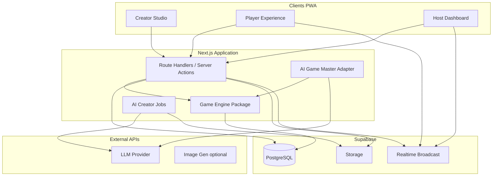
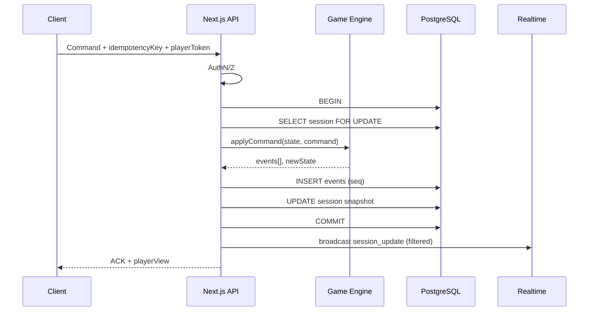

# Architecture — escapeAI

## Visión

Monolito modular desplegable en **Vercel (Next.js)** con **PostgreSQL (Supabase)** como fuente de verdad. Tres capas lógicas estrictas:



## Componentes y responsabilidades

### 1. `packages/game-engine` (núcleo)

- **Sin** dependencias de React, Supabase ni LLM.
- Carga y valida `GameDefinition` (Zod).
- Máquina de estados de sesión (`lobby` → … → `completed`).
- Motor de puzzles determinista (estrategias de validación).
- Aplica **comandos** autorizados → produce **eventos** + nuevo estado derivado.
- Expone proyecciones: vista pública, vista por jugador, vista host (sin soluciones).

### 2. `apps/web` (Next.js App Router)

- UI: Creator Studio, Player, Host (mobile-first PWA).
- **Única puerta** de mutación de partida: valida sesión/token, traduce HTTP/Web a comandos del motor.
- Persiste eventos y snapshot opcional en Postgres.
- Publica en canal Realtime **después** de commit.
- Orquesta jobs de AI Creator (Fase 4+).

### 3. `packages/shared` (contratos)

- Tipos Zod compartidos: definiciones, comandos, eventos, DTOs de API.
- Versionado de esquema (`schemaVersion`).

### 4. AI Creator (Fase 4)

- Pipeline por etapas dentro de un job asíncrono.
- Salida: `GameDefinition` validado + assets en Storage.
- No toca sesiones en vivo.

### 5. AI Game Master (Fase 5)

- Recibe contexto **redactado** (sin soluciones ajenas ni pistas privadas de otros).
- Solo actúa vía **herramientas** que emiten comandos del motor (`emit_narration`, `offer_hint`, `npc_reply`, `trigger_timed_event`, …).
- El motor rechaza comandos ilegales.

## Flujo de mutación (autoridad servidor)



## Comunicación cliente ↔ servidor

| Dirección | Mecanismo MVP | Contenido |
|-----------|---------------|-----------|
| Comandos | HTTPS POST | `SubmitAnswer`, `ShareClue`, `StartGame`, … |
| Estado / eventos | Supabase Realtime channel `session:{id}` | Payload **por rol** vía “private topics” o refetch tras evento |
| Assets | HTTPS + Storage signed URLs | PDF, imágenes, audio |
| IA GM | HTTPS streaming (SSE) | Mensajes; acciones vía tools → comandos |

**Nota privacidad:** el broadcast global de Realtime **no** debe incluir pistas privadas. Patrón MVP:

1. Evento público: “puzzle X resuelto”, “fase cambió”.
2. Cliente recibe señal → `POST /api/sessions/:id/resume` con token → vista filtrada.

Alternativa Fase 2.1: canal Realtime por `playerId` con JWT de scope limitado.

## Seguridad y aislamiento (cerrado)

### Superficie de ataque MVP

| Vector | Mitigación |
|--------|------------|
| Cliente falsifica `playerId` en body | Ignorar body; identidad solo desde token |
| DevTools / otra pestaña | Proyección servidor; tests de aislamiento |
| Supabase anon lee JSON | Sin políticas SELECT en tablas de partida |
| LLM inyecta SQL | GM sin SQL; tools → comandos tipados |
| Scraping invite_code | Códigos 128-bit; rate limit join |

### Qué puede consultar cada actor

| Actor | Fuente | Contenido |
|-------|--------|-----------|
| Jugador | `PlayerViewDTO` | Público + rol propio + pistas propias/compartidas + inventario autorizado |
| Host | `HostViewDTO` + Supabase auth | Progreso agregado; no pistas privadas no compartidas |
| Motor (servidor) | `GameDefinition` + estado completo | Incluye soluciones |
| LLM GM | `GMContext` | Slice público + `PlayerViewDTO` del interlocutor |

### Pipeline de lectura (View / Resume)

```text
token → player_id
→ load state (snapshot + replay)
→ projectPlayerView(state, definition, player_id)
→ assert DTO passes PlayerViewDTOSchema + leak scanner tests
→ JSON response
```

**Leak scanner (CI):** tests fijan estado con pistas A/B; vista de A no contiene substring de contenido B privado.

### Assets

PDF/imagen/QR: URLs firmadas con TTL corto; path no adivinable; QR one-shot opcional ligado a `session_id` + puzzle P2.

## Persistencia

- **Definiciones:** `game_versions.definition_json` (inmutable una vez publicado).
- **Sesiones:** fila `game_sessions` + log `game_events` (seq monótono).
- **Snapshot:** JSON comprimido opcional cada N eventos o en transiciones de fase (replay acelerado).
- **Secrets:** soluciones y respuestas dentro de `definition_json` en BD; nunca en bundle cliente.

## Escalabilidad sin microservicios

| Necesidad | Evolución |
|-----------|-----------|
| Más lecturas Realtime | Canales por sesión; pocos KB/s por partida |
| Jobs IA largos | Worker dedicado o Vercel Workflow; mismo repo |
| Motor CPU-heavy | Extraer `game-engine` a servicio solo si perfiles lo exigen |
| Multi-región | Supabase + Vercel edge para estáticos; sesión sigue en una región |

## Seguridad (principios)

- Organizador: Supabase Auth (JWT).
- Jugador: token opaco `player_session_token` (hash en BD), scope `sessionId + playerId`.
- RLS: organizador ve sus experiencias; **jugadores no leen Postgres directamente** en MVP (solo API). RLS refuerza Creator data.
- Rate limiting en API por IP y por token.
- Auditoría: `game_events` inmutable (soft retention policy documentada en `DATA_MODEL.md`).

## Estructura de repositorio (objetivo Fase 0)

```
escapeAI/
├── apps/web/                 # Next.js PWA
├── packages/
│   ├── game-engine/          # Motor puro + tests
│   └── shared/               # Zod schemas, command/event types
├── docs/                     # Specs (symlink or move from root)
├── ADR/
├── fixtures/
│   └── six-suspects/         # GameDefinition de referencia
└── supabase/migrations/
```

## Referencias cruzadas

- Contratos del motor: `GAME_ENGINE_SPEC.md`
- Multiplayer: `MULTIPLAYER_SPEC.md`
- Datos: `DATA_MODEL.md`
- IA: `AI_ARCHITECTURE.md`
- Plan: `ROADMAP.md`, `IMPLEMENTATION_PLAN.md`
