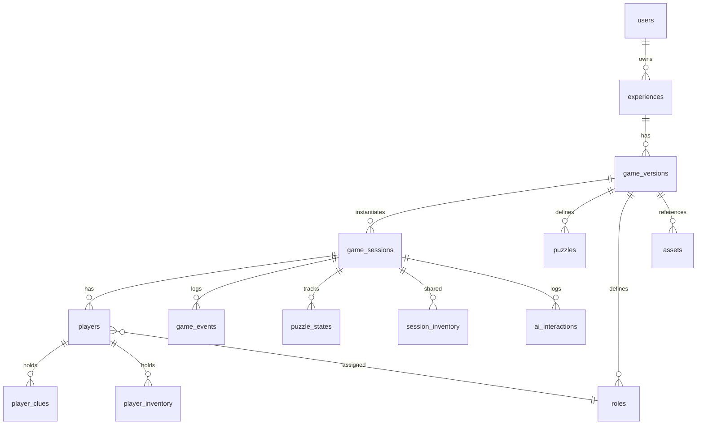

# Data Model — escapeAI

PostgreSQL (Supabase). Identificadores: `uuid` v7 o `uuid` v4; aquí usamos `uuid` genérico. Timestamps en `timestamptz` (UTC).

## Diagrama entidad-relación (núcleo)

## Tablas

### `users`

Organizadores (Supabase Auth `auth.users` + perfil app).

| Columna | Tipo | Notas |
|---------|------|-------|
| id | uuid PK | = auth.users.id |
| email | text | |
| display_name | text | |
| created_at | timestamptz | |

### `experiences`

Contenedor lógico de una aventura (borrador / publicada).

| Columna | Tipo | Notas |
|---------|------|-------|
| id | uuid PK | |
| owner_id | uuid FK users | |
| slug | text unique | opcional URL |
| title | text | |
| status | enum | draft, published, archived |
| created_at, updated_at | timestamptz | |

Índice: `(owner_id, status)`.

### `game_versions`

Definición versionada inmutable tras publicar.

| Columna | Tipo | Notas |
|---------|------|-------|
| id | uuid PK | |
| experience_id | uuid FK | |
| version | int | incremental |
| schema_version | text | ej. `1.0.0` |
| definition_json | jsonb | **GameDefinition** completo |
| definition_hash | text | integridad |
| published_at | timestamptz nullable | |
| created_at | timestamptz | |

Unique: `(experience_id, version)`.

**Importante:** soluciones viven en `definition_json`; acceso solo server-side.

### `assets`

| Columna | Tipo | Notas |
|---------|------|-------|
| id | uuid PK | |
| experience_id | uuid FK | |
| game_version_id | uuid FK nullable | |
| kind | enum | image, pdf, audio, qr_payload |
| storage_path | text | Supabase Storage |
| mime_type | text | |
| metadata_json | jsonb | dimensiones, página, etc. |
| created_at | timestamptz | |

### `game_sessions`

| Columna | Tipo | Notas |
|---------|------|-------|
| id | uuid PK | |
| game_version_id | uuid FK | |
| host_user_id | uuid FK users | organizador |
| invite_code | text unique | corto, no adivinable |
| status | enum | lobby, ready, running, paused, completed, cancelled |
| phase_id | text | fase narrativa actual |
| mode | enum | in_person, remote |
| scheduled_duration_sec | int | ej. 3600 |
| started_at, ended_at | timestamptz | |
| timer_paused_at | timestamptz nullable | |
| timer_elapsed_sec | int | acumulado pausas |
| snapshot_json | jsonb nullable | estado materializado |
| snapshot_event_seq | bigint | último evento incluido en snapshot |
| last_event_seq | bigint | último seq asignado (default 0) |
| settings_json | jsonb | flags host |
| created_at | timestamptz | |

Índices: `(invite_code)`, `(host_user_id, created_at DESC)`.

### `players`

| Columna | Tipo | Notas |
|---------|------|-------|
| id | uuid PK | |
| session_id | uuid FK | |
| slot | int | 1..N |
| display_name | text | |
| role_id | text nullable | ref a RoleDefinition.id |
| connection_status | enum | offline, online |
| last_seen_at | timestamptz | |
| token_hash | text | bcrypt/argon del guest token |
| token_version | int | revocación |
| is_host | boolean | false salvo modo observador |
| created_at | timestamptz | |

Unique: `(session_id, slot)`, `(session_id, display_name)` opcional.

### `puzzle_states`

Estado runtime por puzzle (derivable del log; cache).

| Columna | Tipo | Notas |
|---------|------|-------|
| session_id | uuid FK | |
| puzzle_id | text | |
| status | enum | locked, available, in_progress, solved, skipped |
| attempts | int | |
| solved_at | timestamptz | |
| solved_by_player_id | uuid nullable | |
| data_json | jsonb | progreso parcial no sensible |
| PRIMARY KEY | (session_id, puzzle_id) | |

### `player_clues`

Instancias de pistas asignadas.

| Columna | Tipo | Notas |
|---------|------|-------|
| id | uuid PK | |
| session_id | uuid FK | |
| player_id | uuid FK | |
| clue_id | text | ref ClueDefinition |
| visibility | enum | private, shared, public |
| shared_at | timestamptz nullable | |
| created_at | timestamptz | |

Unique: `(session_id, player_id, clue_id)`.

### `player_inventory` / `session_inventory`

| Tabla | PK | Columnas |
|-------|-----|----------|
| player_inventory | (session_id, player_id, item_id) | qty, metadata_json |
| session_inventory | (session_id, item_id) | qty, metadata_json |

### `game_events`

Log append-only.

| Columna | Tipo | Notas |
|---------|------|-------|
| id | uuid PK | |
| session_id | uuid FK | |
| seq | bigint | UNIQUE(session_id, seq) |
| type | text | |
| payload_json | jsonb | sin secretos en claro si se replican |
| actor_player_id | uuid nullable | |
| created_at | timestamptz | |

Índice: `(session_id, seq)`.

Generación de `seq`: incremento atómico de `game_sessions.last_event_seq` dentro de transacción con `FOR UPDATE` (ver `MULTIPLAYER_SPEC.md`).

### `command_responses`

Cache de idempotencia (respuesta HTTP completa).

| Columna | Tipo | Notas |
|---------|------|-------|
| session_id | uuid FK | |
| idempotency_key | text | |
| http_status | int | |
| body_json | jsonb | `{ seq, events, view }` redactado igual que respuesta live |
| created_at | timestamptz | |
| PRIMARY KEY | (session_id, idempotency_key) | |

TTL opcional: purge >24h tras `session.status` terminal.

### `ai_interactions`

| Columna | Tipo | Notas |
|---------|------|-------|
| id | uuid PK | |
| session_id | uuid FK | |
| player_id | uuid nullable | |
| kind | enum | creator, game_master |
| model | text | |
| input_tokens, output_tokens | int | |
| cost_usd_estimate | numeric | |
| prompt_version | text | |
| tools_called_json | jsonb | |
| created_at | timestamptz | |

### `experience_ai_budgets` (Fase 6)

Presupuesto tokens/coste por experiencia generada.

## Separación público / privado

| Dato | Dónde | Quién lee |
|------|-------|-----------|
| GameDefinition completo | game_versions | API server, Creator |
| Solución puzzle | definition_json.puzzles[].solution | Solo servidor |
| Pista privada contenido | definition + player_clues | Servidor filtra por player_id |
| Eventos globales | game_events | Host + proyección pública |
| Token jugador | players.token_hash | Solo hash |

## Row Level Security (Supabase)

**MVP recomendado**

| Rol DB | Política |
|--------|----------|
| `authenticated` (organizador) | CRUD `experiences` WHERE owner_id = auth.uid(); SELECT versions propias |
| `anon` / `authenticated` | **Sin** SELECT directo a `game_sessions`, `players`, `game_events` |
| `service_role` | API backend usa service role para toda lógica de partida |

Rationale: la lógica de filtrado de pistas es compleja; centralizar en API evita bugs de RLS. Fase posterior: vistas `SECURITY DEFINER` por jugador.

## Retención y borrado

| Entidad | Política sugerida |
|---------|-------------------|
| game_events | 90 días post-completed; agregar a cold storage si analytics |
| ai_interactions | 30 días contenido raw; mantener agregados |
| sessions completed | anonimizar display_name tras 90 días |
| assets | borrar con experience si owner solicita GDPR delete |

## Migraciones y versionado

- Migraciones SQL en `supabase/migrations/`.
- `definition_json` versionado por `schemaVersion`; migrador de definiciones en código si cambia esquema.

## Índices de consulta frecuente

- Unirse a sala: `invite_code`.
- Replay: `(session_id, seq)`.
- Host dashboard: `session_id` + joins players, puzzle_states.
- Creator list: `(owner_id, updated_at)`.
