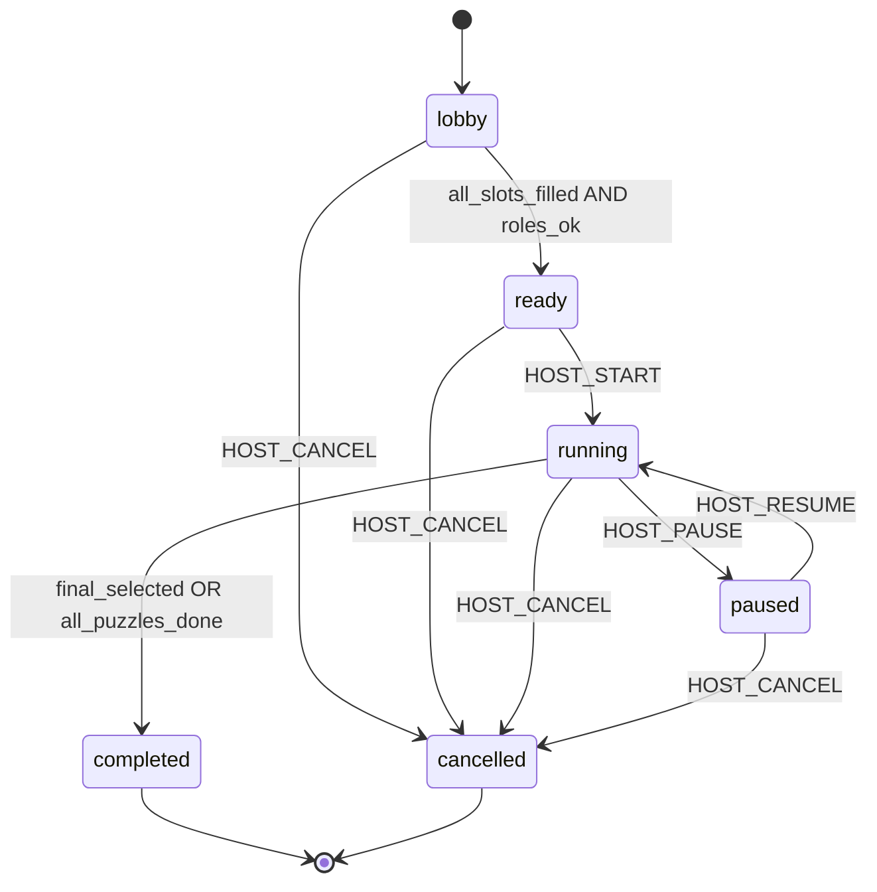

# Game Engine Specification — escapeAI

Motor **determinista**, **puro** (sin I/O), testeable. Entrada: estado + comando; salida: eventos + nuevo estado o error.

## Versionado de esquema

```typescript
export const SCHEMA_VERSION = "1.0.0" as const;
```

Toda `GameDefinition` incluye `schemaVersion`. El validador rechaza versiones desconocidas.

---

## GameDefinition

Experiencia completa publicable.

```typescript
import { z } from "zod";

export const GameDefinitionSchema = z.object({
  schemaVersion: z.literal("1.0.0"),
  id: z.string().min(1),
  title: z.string(),
  locale: z.string().default("es-ES"),
  minPlayers: z.number().int().min(1),
  maxPlayers: z.number().int().max(10),
  estimatedDurationMinutes: z.number().int().positive(),
  modeSupport: z.object({
    inPerson: z.boolean(),
    remote: z.boolean(),
  }),
  phases: z.array(PhaseDefinitionSchema).min(1),
  roles: z.array(RoleDefinitionSchema),
  clues: z.array(ClueDefinitionSchema),
  puzzles: z.array(PuzzleDefinitionSchema),
  inventory: z.object({
    sharedStarts: z.array(ItemGrantSchema).default([]),
  }),
  narrative: z.object({
    intro: z.string(),
    finales: z.array(FinalDefinitionSchema).min(1),
    timedEvents: z.array(TimedNarrativeEventSchema).default([]),
  }),
  assets: z.array(AssetRefSchema).default([]),
  cooperation: z.object({
    requireAllPlayersFor: z.array(z.string()).default([]), // puzzle ids
  }),
});

export type GameDefinition = z.infer<typeof GameDefinitionSchema>;
```

### PhaseDefinition

```typescript
export const PhaseDefinitionSchema = z.object({
  id: z.string(),
  title: z.string(),
  order: z.number().int().nonnegative(),
  puzzleIds: z.array(z.string()), // orden sugerido, no estricto salvo gates
  entryCondition: ConditionSchema.optional(), // ej. puzzles resueltos
  onEnterEventId: z.string().optional(),
});
```

---

## PuzzleDefinition

```typescript
export const PuzzleTypeSchema = z.enum([
  "observation",
  "code",
  "logic",
  "cipher",
  "ordering",
  "association",
  "cooperation",
  "interrogation",
  "narrative_choice",
]);

export const ValidationStrategySchema = z.discriminatedUnion("kind", [
  z.object({ kind: z.literal("exact"), answer: z.string() }),
  z.object({
    kind: z.literal("normalized"),
    answer: z.string(),
    normalize: z.enum(["trim_lower", "alphanumeric", "numeric"]),
  }),
  z.object({
    kind: z.literal("multiple_choice"),
    correctIds: z.array(z.string()).min(1),
  }),
  z.object({
    kind: z.literal("ordering"),
    order: z.array(z.string()),
  }),
  z.object({
    kind: z.literal("combination"),
    requiredItemIds: z.array(z.string()),
  }),
  z.object({
    kind: z.literal("custom_rule"),
    ruleId: z.string(), // registrado en motor, ej. "suspects_alibi_match"
    params: z.record(z.unknown()).optional(),
  }),
]);

export const PuzzleDefinitionSchema = z.object({
  id: z.string(),
  type: PuzzleTypeSchema,
  title: z.string(),
  phaseId: z.string(),
  visibility: z.enum(["public", "role_gated", "player_gated"]),
  requiredRoleIds: z.array(z.string()).optional(),
  assignedPlayerSlots: z.array(z.number()).optional(),
  dependencies: z.object({
    puzzleIds: z.array(z.string()).default([]),
    clueIds: z.array(z.string()).default([]),
    phaseId: z.string().optional(),
  }),
  presentation: PresentationRefSchema, // ver ADR-0008 (digital | printable | qr | audio | physical)
  validation: ValidationStrategySchema,
  progressiveHints: z.array(z.object({
    id: z.string(),
    afterAttempt: z.number().int().optional(),
    afterSeconds: z.number().int().optional(),
    text: z.string(),
  })).default([]),
  unlocks: z.object({
    clueIds: z.array(z.string()).default([]),
    itemIds: z.array(z.string()).default([]),
    puzzleIds: z.array(z.string()).default([]),
  }).default({ clueIds: [], itemIds: [], puzzleIds: [] }),
  cooperation: z.object({
    minDistinctPlayers: z.number().int().min(1).default(1),
    requiresClueIds: z.array(z.string()).default([]),
  }).optional(),
  // Solo servidor — strip antes de enviar al cliente
  solution: z.object({
    internalNotes: z.string().optional(),
  }).optional(),
});

export type PuzzleDefinition = z.infer<typeof PuzzleDefinitionSchema>;
```

**Regla:** la respuesta correcta vive en `validation`, no en LLM.

---

## RoleDefinition

```typescript
export const RoleDefinitionSchema = z.object({
  id: z.string(),
  name: z.string(),
  visibility: z.enum(["public", "secret"]),
  descriptionPublic: z.string(),
  descriptionPrivate: z.string(), // solo jugador con rol
  objectives: z.array(z.string()).default([]),
  grants: z.object({
    clueIds: z.array(z.string()).default([]),
    itemIds: z.array(z.string()).default([]),
    capabilities: z.array(z.enum([
      "interrogate_npc",
      "decrypt_cipher",
      "view_timeline",
      "coordinate_map",
    ])).default([]),
  }),
});
```

Roles iniciales (`investigator`, `cryptographer`, `interrogator`, `analyst`, `explorer`, `coordinator`) son **datos**, no clases TypeScript.

---

## ClueDefinition

```typescript
export const ClueDefinitionSchema = z.object({
  id: z.string(),
  title: z.string(),
  content: z.string(),
  defaultVisibility: z.enum(["private", "shareable"]),
  tags: z.array(z.string()).default([]),
  assetRefs: z.array(z.string()).default([]),
});
```

---

## GameSession (estado runtime)

```typescript
export const SessionStatusSchema = z.enum([
  "lobby",
  "ready",
  "running",
  "paused",
  "completed",
  "cancelled",
]);

export const GameSessionStateSchema = z.object({
  sessionId: z.string().uuid(),
  gameVersionId: z.string().uuid(),
  definitionId: z.string(),
  status: SessionStatusSchema,
  phaseId: z.string(),
  mode: z.enum(["in_person", "remote"]),
  startedAt: z.string().datetime().nullable(),
  timer: z.object({
    durationSec: z.number().int(),
    elapsedSec: z.number().int(),
    paused: z.boolean(),
  }),
  players: z.array(PlayerStateSchema),
  puzzles: z.record(z.string(), PuzzleRuntimeSchema),
  clues: z.record(z.string(), ClueRuntimeSchema), // instancias
  inventory: z.object({
    shared: z.record(z.string(), number()),
    byPlayer: z.record(z.string(), z.record(z.string(), number())),
  }),
  narrative: z.object({
    flags: z.record(z.string(), z.boolean()),
    chosenFinalId: z.string().nullable(),
  }),
  seq: z.number().int().nonnegative(), // último evento aplicado
});
```

---

## Player

```typescript
export const PlayerStateSchema = z.object({
  id: z.string().uuid(),
  slot: z.number().int(),
  displayName: z.string(),
  roleId: z.string().nullable(),
  online: z.boolean(),
  ready: z.boolean(),
});
```

---

## GameEvent

Eventos append-only (persistidos y replayables).

```typescript
export const GameEventSchema = z.discriminatedUnion("type", [
  z.object({ type: z.literal("session.created"), payload: z.object({}) }),
  z.object({ type: z.literal("player.joined"), payload: z.object({ playerId: z.string(), slot: z.number() }) }),
  z.object({ type: z.literal("player.role_assigned"), payload: z.object({ playerId: z.string(), roleId: z.string() }) }),
  z.object({ type: z.literal("session.status_changed"), payload: z.object({ from: SessionStatusSchema, to: SessionStatusSchema }) }),
  z.object({ type: z.literal("phase.entered"), payload: z.object({ phaseId: z.string() }) }),
  z.object({ type: z.literal("puzzle.attempted"), payload: z.object({ puzzleId: z.string(), playerId: z.string(), correct: z.boolean() }) }),
  z.object({ type: z.literal("puzzle.solved"), payload: z.object({ puzzleId: z.string(), playerId: z.string() }) }),
  z.object({ type: z.literal("clue.shared"), payload: z.object({ clueId: z.string(), fromPlayerId: z.string() }) }),
  z.object({ type: z.literal("item.granted"), payload: z.object({ itemId: z.string(), playerId: z.string().nullable() }) }),
  z.object({ type: z.literal("narrative.triggered"), payload: z.object({ eventId: z.string(), text: z.string() }) }),
  z.object({ type: z.literal("final.selected"), payload: z.object({ finalId: z.string() }) }),
  z.object({ type: z.literal("timer.paused"), payload: z.object({}) }),
  z.object({ type: z.literal("timer.resumed"), payload: z.object({}) }),
]);
```

---

## Comandos (entrada al motor)

```typescript
export const GameCommandSchema = z.discriminatedUnion("type", [
  z.object({ type: z.literal("HOST_SET_READY"), playerId: z.string().optional() }),
  z.object({ type: z.literal("HOST_START"), hostPlayerId: z.string() }),
  z.object({ type: z.literal("HOST_PAUSE"), hostUserId: z.string() }),
  z.object({ type: z.literal("HOST_RESUME"), hostUserId: z.string() }),
  z.object({ type: z.literal("HOST_CANCEL"), hostUserId: z.string() }),
  z.object({ type: z.literal("PLAYER_MARK_READY"), playerId: z.string() }),
  z.object({ type: z.literal("PLAYER_CLAIM_ROLE"), playerId: z.string(), roleId: z.string() }),
  z.object({ type: z.literal("SUBMIT_PUZZLE_ANSWER"), playerId: z.string(), puzzleId: z.string(), answer: z.unknown() }),
  z.object({ type: z.literal("SHARE_CLUE"), playerId: z.string(), clueId: z.string() }),
  z.object({ type: z.literal("COOP_PUZZLE_CONTRIBUTE"), playerId: z.string(), puzzleId: z.string(), contribution: z.unknown() }),
  z.object({ type: z.literal("NARRATIVE_CHOICE"), playerId: z.string(), puzzleId: z.string(), choiceId: z.string() }),
  z.object({ type: z.literal("GM_EMIT_NARRATION"), authorized: z.literal(true), text: z.string(), visibility: z.enum(["all", "player"]) }),
  z.object({ type: z.literal("GM_TRIGGER_TIMED_EVENT"), authorized: z.literal(true), eventId: z.string() }),
  z.object({ type: z.literal("GM_GRANT_HINT"), authorized: z.literal(true), puzzleId: z.string(), hintId: z.string() }),
  z.object({ type: z.literal("GM_SET_FLAG"), authorized: z.literal(true), flag: z.string(), value: z.boolean() }),
  z.object({ type: z.literal("GM_INTERROGATION_HIT"), authorized: z.literal(true), keywordId: z.string() }),
]);
```

`authorized: true` solo lo añade el adaptador IA tras validar presupuesto y permisos.

---

## Máquina de estados (sesión)



| Transición | Actor | Validación |
|------------|-------|------------|
| → ready | sistema / host | jugadores == maxPlayers o mínimo configurado; roles únicos si required |
| → running | host | status ready; todos ready opcional |
| → paused | host | status running |
| → completed | motor | condición final en definition |
| → cancelled | host | cualquier estado no terminal |

Estados terminales: `completed`, `cancelled` (sin mutaciones salvo lectura).

### Fases internas

Independientes de `SessionStatus`. While `running`:

- `phaseId` avanza cuando `entryCondition` de la siguiente fase se cumple (puzzles/clues/flags).
- Cambio de fase emite `phase.entered`.

---

## Puzzle engine

### Pipeline de validación

1. ¿Sesión `running` y puzzle no `locked`?
2. ¿Dependencias satisfechas?
3. ¿Jugador autorizado (rol/slot/visibilidad)?
4. ¿Cooperación: contribuciones/distintos jugadores?
5. Ejecutar `ValidationStrategy` registrada.
6. Emitir eventos; actualizar `puzzle_states`; aplicar `unlocks`.

### Reglas custom (ejemplo)

```typescript
type CustomRuleHandler = (
  params: Record<string, unknown>,
  answer: unknown,
  ctx: PuzzleValidationContext
) => boolean;
```

Registro en motor: `registerCustomRule("suspects_alibi_match", handler)`.

### Tipos ↔ estrategias

| PuzzleType | Estrategia típica |
|------------|-------------------|
| observation, code, logic | exact / normalized |
| cipher | normalized + custom_rule |
| ordering | ordering |
| association | combination o multiple_choice |
| cooperation | combination + minDistinctPlayers |
| interrogation | no valida respuesta única; flags narrativos + GM tools |
| narrative_choice | multiple_choice → flags + final weights |

---

## Proyecciones (vistas) — contrato cerrado

```typescript
function projectPlayerView(
  state: GameSessionState,
  definition: GameDefinition,
  playerId: string
): PlayerViewDTO;

function projectHostView(
  state: GameSessionState,
  definition: GameDefinition
): HostViewDTO;
```

### PlayerViewDTO (lo único que recibe un jugador)

```typescript
export const PlayerViewDTOSchema = z.object({
  sessionId: z.string().uuid(),
  seq: z.number().int(),
  status: SessionStatusSchema,
  phaseId: z.string(),
  timer: z.object({ remainingSec: z.number().int(), paused: z.boolean() }),
  me: z.object({
    playerId: z.string().uuid(),
    displayName: z.string(),
    role: z.object({
      id: z.string(),
      name: z.string(),
      description: z.string(), // pública + privada merged solo para este rol
    }).nullable(),
    objectives: z.array(z.string()),
  }),
  team: z.array(z.object({
    playerId: z.string().uuid(),
    displayName: z.string(),
    roleName: z.string().nullable(), // solo nombres públicos de rol
    online: z.boolean(),
  })),
  clues: z.array(z.object({
    clueId: z.string(),
    title: z.string(),
    content: z.string(),
    visibility: z.enum(["private", "shared", "public"]),
  })), // solo instancias asignadas a este player OR shared/public
  puzzles: z.array(z.object({
    puzzleId: z.string(),
    type: PuzzleTypeSchema,
    title: z.string(),
    status: z.enum(["locked", "available", "in_progress", "solved"]),
    presentation: PresentationRefSchema,
    // NUNCA: validation, solution, progressiveHints text completo hasta unlock
    hintsAvailable: z.number().int(), // cuenta, no texto futuro
  })),
  inventory: z.object({
    mine: z.record(z.string(), z.number()),
    shared: z.record(z.string(), z.number()),
  }),
  narrativeFeed: z.array(z.object({ id: z.string(), text: z.string(), at: z.string() })),
});
```

### Reglas de filtrado (obligatorias en tests)

| Dato | Regla |
|------|-------|
| `validation` / respuesta correcta | **Nunca** en DTO |
| Pista privada de otro jugador | **Nunca** aunque `game_events` exista |
| Pista `shared` | Visible si `player_clues.visibility` ∈ {shared, public} para cualquier holder |
| Rol secreto ajeno | Solo `roleName` público en `team` |
| Puzzle locked | Solo id/title/status locked; sin presentation que filtre solución |
| Progressive hints | Texto solo tras evento `hint.granted` para ese player/puzzle |

### HostViewDTO

Igual que agregado de puzzles (estados, intentos), jugadores, timer, fases; **sin** soluciones ni contenido de pistas privadas no compartidas.

Strip global en servidor: `validation`, `solution`, `definition_json` completo.

---

## API interna del paquete

```typescript
export function createInitialState(
  definition: GameDefinition,
  sessionMeta: SessionMeta
): GameSessionState;

export function applyCommand(
  definition: GameDefinition,
  state: GameSessionState,
  command: GameCommand,
  ctx: CommandContext
): { state: GameSessionState; events: GameEvent[] } | EngineError;

export function replayEvents(
  definition: GameDefinition,
  initial: GameSessionState,
  events: GameEvent[]
): GameSessionState;
```

---

## Fixture de referencia

- `fixtures/six-suspects/EXPERIENCE_DESIGN.md` — diseño narrativo/mechanics cerrado
- `fixtures/six-suspects/game-definition.json` — experiencia MVP (Fase 3)
