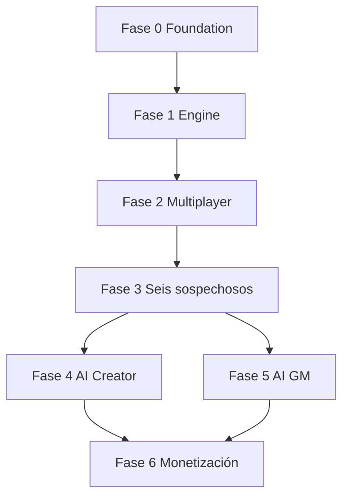

# Roadmap — escapeAI

Fases secuenciales. **No avanzar** si los criterios de aceptación de la fase anterior no se cumplen.

---

## Fase 0 — Architecture Foundation

**Objetivo:** Repo implementable, contratos, BD, CI, fixture de referencia.

| Entregable | Detalle |
|------------|---------|
| Monorepo | pnpm workspaces: `apps/web`, `packages/game-engine`, `packages/shared` |
| TypeScript strict | shared configs |
| Zod schemas | export desde `packages/shared` |
| Migraciones Supabase | tablas núcleo |
| ADRs iniciales | ver `ADR/` |
| Fixture | `fixtures/six-suspects/` (stub JSON válido mínimo al inicio) |
| CI | lint, typecheck, unit tests motor |

**Criterios de aceptación (cerrados)**

- [ ] Monorepo pnpm: `apps/web`, `packages/game-engine`, `packages/shared` compilable
- [ ] `pnpm test` ejecuta Vitest en `game-engine` (≥1 test placeholder verde)
- [ ] Schemas Zod en `shared` exportan tipos de `GAME_ENGINE_SPEC.md` (subset: status, command, event)
- [ ] Migración `0001_core.sql` incluye: `game_sessions.last_event_seq`, `command_responses`, tablas núcleo
- [ ] `SessionCommandService` **stub** documentado en código con comentario ref a `MULTIPLAYER_SPEC.md` (implementación completa Fase 2)
- [ ] Fixture `fixtures/six-suspects/game-definition.stub.json` pasa `GameDefinitionSchema`
- [ ] CI: typecheck + test en PR
- [ ] README enlaza docs + `EXPERIENCE_DESIGN.md`
- [ ] ADR-0009 presente

**Dependencias:** ninguna.

---

## Fase 1 — Game Engine

**Objetivo:** Motor determinista completo sin UI.

| Entregable | Detalle |
|------------|---------|
| State machine | lobby → cancelled/completed |
| Puzzle validators | todas las estrategias MVP |
| Dependencias y unlocks | |
| Fases | |
| Timer | lógica pause/resume |
| Event replay | |
| Custom rules | al menos 1 para Seis sospechosos |

**Criterios de aceptación**

- [ ] ≥90% branch coverage en transiciones y validación (objetivo pragmático)
- [ ] Replay de eventos reproduce estado idéntico
- [ ] Tests de regresión por tipo de puzzle
- [ ] Proyecciones player/host strip secrets

**Dependencias:** Fase 0.

---

## Fase 2 — Multiplayer

**Objetivo:** API + Realtime + guest join + host dashboard mínimo.

| Entregable | Detalle |
|------------|---------|
| Crear sesión / invite | |
| Join guest + token | |
| Command API idempotente | |
| View API filtrada | |
| Realtime signals | |
| Presencia básica | |
| Host dashboard web | |
| Player shell PWA | |

**Criterios de aceptación**

- [ ] Harness simula 6 jugadores concurrentes
- [ ] Idempotency y race tests verdes
- [ ] Reconexión documentada y probada
- [ ] Host pausa/reanuda visible en todos los clientes

**Dependencias:** Fase 1.

---

## Fase 3 — Primera experiencia jugable

**Objetivo:** *El caso de los seis sospechosos* completo manual.

| Entregable | Detalle |
|------------|---------|
| `game-definition.json` completo | 7 puzzles, roles, clues |
| Assets | PDF, imágenes, QR |
| UI player pulida | mobile-first |
| Instrucciones host | preparación física |
| Playtest interno | 1 sesión real |

**Criterios de aceptación**

- [ ] 6 jugadores completan en ≤75 min (testers)
- [ ] QR + PDF usados en flujo
- [ ] Final diverge según al menos 2 decisiones
- [ ] Sin fugas de solución en DevTools

**Dependencias:** Fase 2.

---

## Fase 4 — AI Creator

**Objetivo:** Brief → GameDefinition validado.

| Entregable | Detalle |
|------------|---------|
| Job orchestrator | |
| Prompts versionados | |
| Validador estructural + coherencia | |
| Creator Studio forms | |
| Edición manual post-gen | |
| Publish | |

**Criterios de aceptación**

- [ ] Generar borrador jugable desde brief de prueba
- [ ] Fallos Zod bloquean publish
- [ ] Presupuesto tokens respetado
- [ ] Regeneración parcial de una fase funciona

**Dependencias:** Fase 3 (fixture como gold standard).

---

## Fase 5 — AI Game Master

**Objetivo:** NPC + hints + narración acotada.

| Entregable | Detalle |
|------------|---------|
| GM adapter + tools | |
| Chat SSE | |
| Interrogatorio híbrido | keywords deterministas |
| Timed narrative trigger | |
| Tests seguridad contexto | |

**Criterios de aceptación**

- [ ] GM no revela pistas ajenas en suite de tests
- [ ] Límite mensajes/jugador enforced
- [ ] Sospechoso IA mejora UX vs script (playtest)

**Dependencias:** Fase 3; Fase 4 opcional para nuevas aventuras.

---

## Fase 6 — Monetización

**Objetivo:** Organizador paga; analítica; límites IA.

| Entregable | Detalle |
|------------|---------|
| Stripe (o similar) | |
| Planes | |
| Cuotas Creator/GM | |
| Analytics eventos | |

**Criterios de aceptación**

- [ ] Flujo pago → crédito experiencia
- [ ] Bloqueo generación si sin crédito
- [ ] Dashboard uso IA

**Dependencias:** Fase 4–5 según feature gating.

---

## Diagrama de dependencias

---

## Riesgos de roadmap

| Riesgo | Fase | Mitigación |
|--------|------|------------|
| UI antes de motor | 2 | Bloquear Fase 2 sin tests Fase 1 |
| IA antes de playtest | 4–5 | Fase 3 obligatoria |
| Realtime bugs | 2 | Harness + señal + pull views |
