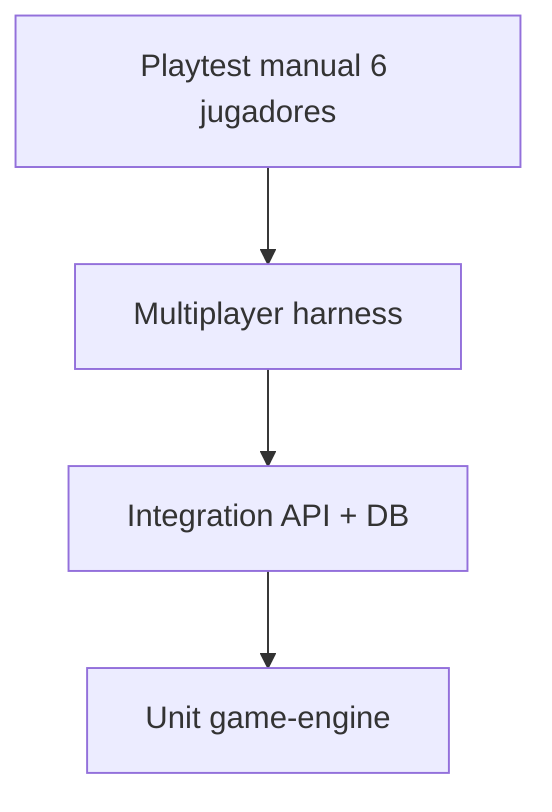

# Testing Strategy — escapeAI

## Pirámide

## Unit tests (`packages/game-engine`)

| Área | Casos |
|------|-------|
| State machine | Transiciones válidas/inválidas; terminales |
| Puzzle validation | Cada `ValidationStrategy`; normalización |
| Dependencies | Locked hasta unlock |
| Permissions | Rol/slot/visibilidad |
| Clue distribution | Grants al start; share |
| Timer | Pause/resume elapsed |
| Replay | Mismo estado que apply incremental |
| Projections | No leaks validation/solution |

Framework: **Vitest**. Fixture: `fixtures/six-suspects/`.

## Integration tests (`apps/web` o `packages/server-tests`)

| Flujo | Verificación |
|-------|--------------|
| Create session | invite_code único |
| Join ×6 | tokens distintos |
| Assign roles | unicidad |
| Start | status running + clues |
| Submit correct/wrong | events + attempts |
| Share clue | otro view |
| Idempotency | duplicate key |
| Host pause | timer flag |

DB: Supabase local o Testcontainers Postgres.

## Multiplayer tests

Harness `SimClient` con fetch + optional Realtime mock:

- Respuestas simultáneas mismo puzzle
- Eventos duplicados (retry red)
- Desconexión mid-game → reconnect + view
- Permisos: jugador A no ve clue B

Simular reinicio: reload state from snapshot + replay.

## Aislamiento entre jugadores (estrategia cerrada)

### Nivel 1 — Motor (`packages/game-engine`)

| Test | Método |
|------|--------|
| `leak_clues_cross_player` | Estado con `clue_alibi_marcos` / `clue_alibi_lucia`; `projectPlayerView(A)` no contiene strings de B |
| `leak_validation` | Ningún DTO serializado contiene claves `validation`, `solution`, `answer` |
| `locked_puzzle_presentation` | Puzzle locked no expone `presentation` con payload secreto (si aplica regla definition) |
| `shared_clue_after_share` | Tras `SHARE_CLUE`, terceros ven contenido; antes no |

Implementación: helper `expectViewNotContains(view, forbidden: string[])`.

### Nivel 2 — API (Fase 2)

| Test | Método |
|------|--------|
| Token A no accede view B | Intercambiar tokens → 403 o view sin datos ajenos |
| `command_responses` cache | Misma idempotency no duplica eventos |
| Concurrencia | 2 POST paralelos mismo puzzle → 1 solo `puzzle.solved` |

### Nivel 3 — GM (Fase 5)

| Test | Método |
|------|--------|
| Context builder | Snapshot GM para player A sin campos `clues` de B |
| Tool abuse | LLM mock pide `get_all_clues` → adapter rechaza |
| Hint no solución | `grant_progressive_hint` text distance from answer |

### CI obligatorio

- Fase 1+: tests nivel 1 en cada PR touching engine/projections.
- Fase 2+: nivel 1 + 2 en PR touching API.

## AI tests (Fase 4–5)

| Tipo | Método |
|------|--------|
| Structural Creator output | Zod + graph rules |
| GM leakage | Prompts adversariales; assert no tool prohibido |
| NPC consistency | Snapshot responses con mock LLM |
| Cost | budget exceeded → 429 |

Mock LLM: respuestas grabadas en CI; live opcional nightly.

## CI

- PR: unit + integration (sin LLM live)
- Main: + harness 6 players
- Optional: nightly playtest checklist manual

## Cobertura

Objetivo pragmático: **motor ≥90%** branches críticos; UI smoke mínimo hasta Fase 3.

## Experiencia de referencia

Toda suite referencia **El caso de los seis sospechosos** como golden definition; cambios en JSON requieren revisión explícita de tests.
