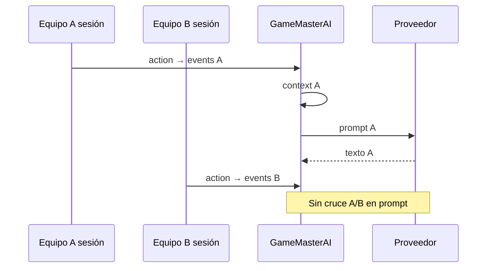

# GameMasterAI — GM-0: Auditoría, arquitectura y diseño

**Estado:** diseño aprobado pendiente (sin implementación en GM-0).  
**Repositorio auditado:** `main` @ `029b328` (2026-03-25 aprox., incluye ScannerAI / spatial sites #38).  
**Producción:** https://escapeai-self.vercel.app

---

## 1. Diagnóstico del estado real de EscapeAI

### 1.1 Lo que está implementado en `main`

| Área | Estado | Ubicación / notas |
|------|--------|-------------------|
| Monorepo pnpm (shared, engine, content, api, web) | OK | Raíz |
| Motor determinista (sesión, puzzles, inventario, escenas, win/loss, tiempo) | OK | `packages/escape-engine` |
| Acciones tipadas | OK | `packages/shared` → `applyAction` en engine |
| Salas YAML (`pilot`, `lighthouse`, labs) | OK | `packages/escape-content/rooms/` |
| Generador de eventos personalizados | OK | `generate-adventure.ts` — códigos derivados de `subject` + `facts` |
| Multiplayer por equipos (2–5), join code, sesión/equipo | OK | `events-routes.ts`, `event-store.ts`, `shared/events.ts` |
| Leaderboard + panel organizador (polling 8s, modo proyector) | OK | `EventOrganizerBoard.tsx`, `GET /events/:code/leaderboard` |
| Persistencia sesiones/eventos Redis/KV (Upstash) o memoria/archivo | OK | `redis-session-store.ts`, `createEventStore` |
| Puzzles sensoriales (sound, voice, camera, visual, location) | OK | Engine + `InteractivePuzzle.tsx` |
| OCR cámara (cliente) | OK | `ocr_hint` en web; validación sigue en servidor |
| Voz (Web Speech + Vosk opcional), TTS local en puzzles | OK | `speech-tts.ts`, `vosk-listen.ts` |
| ScannerAI — inventario semántico (entorno / site multi-habitación) | OK | `packages/shared/scanner*.ts`, API `scanner-routes`, `site-routes`, UI `apps/web/src/scanner/` |
| Aventuras espaciales desde scan + `PuzzleClueSpec` (tipos) | OK | `spatial-adventure.ts`; salas generadas en `spatial/build-*.ts` |
| Mapa 2D visitas (`spatialSiteMap` en `PublicState`) | OK | Engine `toPublicState` |
| **Narrador IA actual** (“orquestador”) | Parcial | `orchestrator.ts` — no es GameMasterAI |
| Personajes conversacionales | **No** | Sin contrato ni endpoints |
| Detección automática de bloqueo (`TEAM_STUCK`) | **No** | Solo `request_hint` manual |
| GameMaster como capa con eventos enriquecidos | **No** | `GameEvent` mínimo en shared |

### 1.2 Documentación desactualizada (no confiar sin verificar código)

| Documento | Problema |
|-----------|----------|
| `docs/mvp-audit-phase-a.md` | Afirma que eventos/equipos **no están en main** — **obsoleto** tras consolidación MVP. |
| `docs/mvp-consolidation-summary.md` | Describe trabajo en rama; gran parte ya está en `main`. |
| `docs/architecture.md` | Cita solo sesiones en memoria; no menciona ScannerAI ni GameMaster. |
| `docs/product-generic-experiences.md` | Habla de “jugadores 1–20” individuales; código usa **`teamCount` 2–5**. |

### 1.3 Narrador actual vs GameMasterAI

El **orquestador** (`apps/api/src/orchestrator.ts`):

- Se invoca en `POST /sessions` (intro), `POST .../actions` (condicional) y `POST .../orchestrate`.
- Dispara LLM solo si hay `DEEPSEEK_API_KEY` u `OPENAI_API_KEY` (prioridad DeepSeek).
- Usa Vercel AI SDK (`generateText`) con `toAiContext(session)` — **sin respuestas estructuradas**.
- Eventos que activan LLM: `puzzle_failed`, `scene_entered`, `game_won`, `game_lost`, `hint_requested` — **no** `puzzle_solved`, `take_item`, etc.
- En `hint_requested`: el engine **ya escribe** la pista YAML en `narrative[]`; el orquestador añade otra capa (o fallback que repite pista curada).
- Fallback: textos fijos + eco de `puzzle.hints[level].text`.
- La UI muestra badge “Narrador IA” solo si `source !== "fallback"` (`App.tsx`).
- **No hay** timeout explícito, cola, deduplicación, límites por sesión ni validación de salida más allá de recortar texto.

### 1.4 ScannerAI — integración con el juego

- **ScannedEnvironment** (una habitación) y **ScannedSite** (varias + exterior + topología) se persisten en KV vía stores dedicados.
- Propuestas de aventura: `POST .../proposals` → `SpatialAdventureProposal` con `PuzzleClueSpec` (dependencias entre pistas, `outputType`, `validationRule`).
- Crear evento desde scan: genera `RoomDefinition` determinista (`buildSpatialRoom` / `build-site-room`) y luego **mismo flujo** evento + sesión por equipo.
- El motor **no** ejecuta lógica de scanner; solo consume YAML/room generado.
- **GameMasterAI no está conectado** al scanner; el contexto espacial llega al jugador vía `PublicState.spatialSiteMap`, no al LLM hoy.

### 1.5 Brechas respecto a la visión GameMasterAI

1. Sin separación clara narrador vs director vs pistas vs personajes.
2. Sin política de información (el prompt incluye `prompt` de puzzles — riesgo de filtrado débil).
3. Sin eventos de progresión rica (`CLUE_DISCOVERED`, `PASSAGE_UNLOCKED`, `TIME_WARNING`, etc.).
4. Sin historial narrativo dedicado (solo `session.narrative[]` mezclando log de motor + IA).
5. Sin aislamiento formal de contexto LLM por equipo (existe aislamiento de **sesión**, pero no hay capa de “vista GM”).
6. Sin integración organizador ↔ GameMaster (solo leaderboard agregado).

---

## 2. Diagrama de arquitectura propuesta

```mermaid
flowchart TB
  subgraph Client["PWA (apps/web)"]
    UI[UI juego / eventos / scanner]
  end

  subgraph API["API Hono (apps/api)"]
    Routes[Rutas sesión / eventos / scanner]
    GM[GameMasterAI Service]
    Orch[Orchestrator legado → absorber en GM]
    LLM[LlmProvider abstraction]
  end

  subgraph Engine["Escape Engine (determinista)"]
    Apply[applyAction]
    State[SessionRecord]
  end

  subgraph Data["Persistencia"]
    Redis[(Upstash KV)]
    Content[escape-content YAML + generadores]
  end

  UI -->|GameAction| Routes
  Routes --> Apply
  Apply --> State
  Apply -->|GameEvent[]| GM
  GM -->|GmViewContext build| GM
  GM -->|intervención| LLM
  GM -->|NarrativeBundle| Routes
  Routes -->|PublicState + interventions| UI
  State --> Redis
  Content --> State
  GM -.->|solo lectura| Content
```

**Principio:** flechas de escritura al estado del juego terminan en **Engine**; GameMasterAI solo **lee** y **emite textos** validados.

---

## 3. Responsabilidades y límites de GameMasterAI

### 3.1 Escape Engine (inalterable en responsabilidad)

Validar respuestas, inventario, escenas, condiciones, victoria/derrota, tiempo, emisión de `GameEvent` del dominio juego.

### 3.2 GameMasterAI — puede

| Capacidad | Descripción |
|-----------|-------------|
| Observar | Consumir eventos + `GmViewContext` filtrado |
| Narrar | Textos inmersivos, diálogos (un LLM, múltiples perfiles) |
| Dirigir | Triggers de ritmo (bienvenida, acto, urgency) |
| Sugerir pistas | **Solo** textos de `hints[]` / política de clue autorizada — parafrasear, no inventar |
| Detectar bloqueo | Heurística sobre intentos, tiempo, pistas no usadas |
| Personalizar epílogo | Con datos reales de sesión (puzzles resueltos, tiempo, equipo) |

### 3.3 GameMasterAI — prohibido

- Cambiar `SessionRecord` (inventario, escenas, respuestas correctas).
- Ejecutar o sugerir acciones `GameAction` parseables.
- Recibir `answer` de puzzles, soluciones de otros equipos, props de otros scans sin autorización.
- Sustituir validación de puzzles sensoriales.
- Crear colas/microservicios sin necesidad demostrada (ver §7).

---

## 4. Contratos y eventos

### 4.1 Eventos existentes (`packages/shared`)

```ts
// Implementado hoy
type GameEvent =
  | { type: "puzzle_solved"; puzzleId: string }
  | { type: "puzzle_failed"; puzzleId: string; attempts: number }
  | { type: "scene_entered"; sceneId: string }
  | { type: "hint_requested"; puzzleId: string; level: number }
  | { type: "game_won" }
  | { type: "game_lost" };
```

### 4.2 Eventos propuestos para GameMaster (`GmEngineEvent`)

Extienden el stream del motor **sin** sustituir `GameEvent` en GM-1 inicial; pueden emitirse desde engine o desde un adaptador en API:

| id | Origen | Prioridad | GM procesa |
|----|--------|-----------|------------|
| `SESSION_STARTED` | API al crear sesión | alta | bienvenida / misterio |
| `SCENE_ENTERED` | ya existe | media | ambientación (estático o LLM) |
| `PUZZLE_ATTEMPT_FAILED` | ya existe como `puzzle_failed` | baja | reacción breve |
| `PUZZLE_SOLVED` | ya existe, **no orquestado** | media-alta | celebración / puente narrativo |
| `HINT_GRANTED` | tras `request_hint` (nivel N) | media | parafraseo opcional |
| `ITEM_TAKEN` | nuevo (engine) | baja | descubrimiento |
| `PASSAGE_UNLOCKED` | derivado de exits disponibles | media | transición |
| `TIME_WARNING` | API timer (25%, 10%, 5 min) | alta | director |
| `TEAM_STUCK` | heurística GM | media-alta | oferta pista gradual |
| `CHARACTER_TURN` | acción jugador futura | alta | personaje |
| `GAME_ENDED` | won/lost | alta | desenlace |

**Metadatos comunes (propuesta):**

```ts
type GmEngineEvent = {
  id: string;              // uuid, idempotencia
  type: string;
  sessionId: string;
  teamId?: string;
  eventJoinCode?: string;
  adventureId: string;     // roomId o eventId
  atMs: number;
  payload: Record<string, unknown>;
  visibility: "team" | "organizer";
  priority: 0 | 1 | 2 | 3;  // 3 = inmediato
  dedupeKey?: string;       // ej. TIME_WARNING:600
};
```

**Procesamiento:** síncrono en la misma petición HTTP para MVP (como hoy), con timeout corto; **no** Redis Streams en GM-1.

**Persistencia:** anexar `gmInterventions[]` en sesión serializada o subclave Redis — decisión pendiente (§15).

### 4.3 Contrato de respuesta narrativa (`NarrativeIntervention`)

```ts
type NarrativeChannel = "narration" | "character" | "hint" | "organizer" | "notification";

type NarrativeIntervention = {
  id: string;
  sourceEventId: string;
  kind: NarrativeChannel;
  text: string;
  characterId?: string;
  spoilerLevel: 0 | 1 | 2 | 3; // 0=público, 3=solución
  clueRefs?: string[];         // puzzleId + hint level
  presentation: "inline" | "banner" | "modal" | "tts_future";
  meta: {
    provider?: "static" | "deepseek" | "openai";
    model?: string;
    latencyMs?: number;
    cached?: boolean;
  };
};
```

Validación pre-entrega: longitud máx., denylist (códigos/soluciones extraídos de room **no presentes en contexto**), comprobación de que `clueRefs` existen en YAML.

---

## 5. Estrategia de contexto y memoria narrativa

### 5.1 Capas de información

| Capa | Contenido | ¿LLM? |
|------|-----------|-------|
| Pública aventura | Título, tono, sinopsis autorizada del room | Sí |
| Equipo | Escena actual, inventario, puzzles **activos** (sin answer) | Sí |
| Progreso | IDs resueltos, intentos, hintsUsed, últimas acciones | Sí |
| Pista solicitada | Solo `hints[level-1].text` del puzzle actual | Sí (parafraseo) |
| Secreto | `answer`, puzzles futuros no activos, otros equipos | **Nunca** |
| Organizador | Agregados leaderboard | Endpoint separado, sin mezclar en prompt equipo |

### 5.2 `GmViewContext` (reemplazo evolutivo de `AiContext`)

Constructor en API (`buildGmViewContext(session, trigger)`):

- Incluir `spatialRoomLabel` / visita si hay `spatialSiteMap`.
- Excluir `puzzle.prompt` si contiene datos demasiado reveladores — usar `label` + `interactionHints` en su lugar (decisión GM-1).
- `recentInterventions` (últimas 5, no todo `narrative[]`).
- `toneProfile` desde `adventureType` + `durationMin`.
- Para eventos generados: `facts` autorizados **sin** códigos derivados.

### 5.3 Memoria

- **Corto plazo:** ventana deslizante en sesión (intervenciones + 3 escenas).
- **Largo plazo:** no embedding store en GM-1; el motor ya conserva log completo en `narrative[]` para UI.
- **Caché segura:** textos estáticos por `(roomId, sceneId, eventType)` — sin datos personales.

---

## 6. Diseño de aislamiento multiplayer

### 6.1 Estado actual (suficiente como base)

- Un `StoredEvent` → N equipos → N `sessionId` independientes.
- Redis keys: `escapeai:session:{id}`, `escapeai:event:{joinCode}`.
- Leaderboard sincroniza métricas agregadas sin narrativa de otros equipos.

### 6.2 Reglas GameMaster

1. Toda llamada LLM lleva `sessionId` → una sola sesión.
2. `buildGmViewContext` **nunca** recibe `StoredEvent` completo ni lista de equipos (salvo modo organizador futuro).
3. Rate limit por `sessionId` (ej. 40 intervenciones LLM / partida).
4. Un servicio lógico singleton en API (stateless Vercel): sin agente por equipo; contexto en KV.



---

## 7. Diseño del sistema de pistas (GM-2 preview en arquitectura)

### 7.1 Fuente de verdad

- Pistas: `RoomPuzzle.hints[]` (`level`, `text`) + `maxHints`.
- Espacial: `PuzzleClueSpec` define dependencias; el generador mapea a puzzles con hints en YAML generado.
- El engine incrementa `puzzleHintsUsed` y emite `hint_requested`.

### 7.2 Gradación (alineada con YAML)

| Nivel GM | Fuente engine | Ejemplo reloj |
|----------|---------------|---------------|
| 1 Ambiental | hint level 1 o copy estático escena | «El tiempo se ha detenido…» |
| 2 Contextual | hint level 2 | «Observad las agujas» |
| 3 Explícita | hint level 3 | «Las agujas son dos cifras» |
| 4 Extra | solo si `maxHints` y contenido autorizado | Texto curator, no LLM libre |

### 7.3 Detección de bloqueo (`TEAM_STUCK`)

Heurística **sin LLM** (engine/API):

- Puzzle activo no resuelto AND `attempts >= 3` AND sin progreso en 4 min AND `hintsUsed < maxHints`.
- O: jugador pidió hint 0 veces y `elapsedSec > 0.35 * timeLimitSec` en mismo puzzle.

Acción: notificación **opcional** “¿Necesitáis un empujón?” → no auto-consumir hint (el jugador mantiene control).

### 7.4 Anti-spoiler

- Filtrar puzzles en escenas no visitadas y exits bloqueados.
- En salas multi-habitación (`spatialSiteMap`), solo habitaciones con `visitedOrder <= current`.

---

## 8. Personajes conversacionales (GM-3 preview)

**No implementado.** Diseño con un solo LLM y perfiles:

```ts
type CharacterProfile = {
  id: string;
  displayName: string;
  voiceTone: string;
  backstoryPublic: string;
  knowledgeTags: string[];   // referencias a factIds / sceneIds
  revealRules: Array<{ when: Condition; tell: string }>;
  forbiddenTopics: string[];
  goals: string[];
};
```

Flujo: jugador envía `GameAction` futuro `talk_to_character` → API valida disponibilidad en escena → `GmViewContext` con **solo** `knowledgeTags` resueltos → LLM responde como personaje → validador anti-solución.

Contenido inicial: ficheros YAML junto a salas o extension en `generate-adventure` para tipo `mystery`.

---

## 9. Seguridad narrativa y control de spoilers

| Riesgo | Mitigación arquitectónica |
|--------|---------------------------|
| Prompt injection (respuestas jugador) | Sanitizar; personaje en sistema aparte; no concatenar input crudo en system prompt |
| Nombres / notas ScannerAI | Ya existe `sanitizeScannedEnvironmentInput`; GM nunca ingiere JSON scan crudo |
| Alucinaciones con solución | Contexto sin `answer`; validador regex contra patrones de dígitos/códigos del room |
| Repetición | Hash últimas 3 intervenciones; si similar, forzar plantilla estática |
| Coste / abuso | Límite por sesión; cooldown 3s entre llamadas LLM |
| LLM caído | Ver §11 |

---

## 10. Proveedores LLM y costes (estimación)

### 10.1 Estado actual

`resolveLlmConfig()`: prioridad **DeepSeek** (`deepseek-chat`), fallback OpenAI (`gpt-4o-mini`). SDK: `ai` + `@ai-sdk/openai`.

### 10.2 Abstracción propuesta

```ts
interface LlmProviderAdapter {
  tier: "economy" | "standard";
  completeStructured<T>(spec: { system; user; schema }): Promise<T>;
}
```

Enrutado: estático (0$) → economy (narración/pistas) → standard (personajes complejos, GM-3).

### 10.3 Hipótesis de coste (no verificadas en facturación)

| Hipótesis | Valor |
|-----------|-------|
| Tokens entrada / salida por intervención | ~600 / ~80 |
| Modelo economy | DeepSeek-chat ~ $0.14 / $0.28 por 1M tokens (orden magnitud público 2025) |
| Intervenciones LLM por equipo / 60 min | 10 (ligero), 30 (medio), 60 (intenso) |

| Escenario | Equipos | Interv./equipo | Interv. totales | Tokens ~ (M) | Coste economy ~ |
|-----------|---------|----------------|-----------------|--------------|-----------------|
| Sara ligero | 5 | 10 | 50 | 0.034 | **< $0.01** |
| Sara medio | 5 | 30 | 150 | 0.102 | **~ $0.02–0.05** |
| Sara intenso | 5 | 60 | 300 | 0.204 | **~ $0.05–0.10** |
| Evento grande | 10 | 30 | 300 | 0.204 | similar |
| Evento XL | 20 | 30 | 600 | 0.408 | **~ $0.10–0.20** |

**Nota:** GM-1 debe medir tokens reales en Vercel logs; cifras orientativas.

---

## 11. Fallback y fiabilidad

| Mecanismo | Propuesta |
|-----------|-----------|
| Timeout LLM | 4s (Vercel function); abort |
| Reintentos | 1 retry con jitter |
| Fallback | `FALLBACK_LINES` + hints YAML (como hoy, centralizado en GM) |
| Juego sin IA | `applyAction` sin await bloqueante > 5s; si falla, respuesta sin `orchestrator` |
| Duplicados | `dedupeKey` por `(sessionId, eventType, puzzleId)` en ventana 30s |
| Observabilidad | log estructurado: `gm_latency_ms`, `gm_fallback`, `gm_provider` |

**Criterio:** caída GM nunca impide resolver puzzle ni `move` con exit disponible.

---

## 12. Roadmap de implementación

| Fase | Alcance | Depende de |
|------|---------|------------|
| **GM-0** | Este documento | — |
| **GM-1** | Narrador dinámico + triggers + `NarrativeIntervention` + refactor orquestador | Aprobación GM-0 |
| **GM-2** | Pistas inteligentes + `TEAM_STUCK` | GM-1 |
| **GM-3** | Personajes | GM-1 + contenido |
| **GM-4** | TTS / voces | GM-1 + web audio |
| **GM-5** | Dirección adaptativa avanzada | GM-2 |

---

## 13. MVP recomendado (GM-1)

1. Renombrar conceptualmente orquestador → **`GameMasterService`** (mismo deploy).
2. Implementar `buildGmViewContext` + política de exclusión de secretos.
3. Tabla de triggers: qué eventos usan estático vs LLM (p. ej. `puzzle_solved` → estático con plantilla personalizada por `nickname`).
4. Unificar salida en `NarrativeIntervention[]`; UI muestra inline en diario (como hoy).
5. Time warnings vía job en cliente (poll) o en `GET /sessions/:id` — sin cron.
6. Métricas en `/health` extendidas (`gm: { fallbackRate }` opcional).
7. **No** personajes ni stuck automático en MVP (solo manual hint).

---

## 14. Archivos previstos en GM-1 (sin modificar en GM-0)

| Archivo | Cambio |
|---------|--------|
| `apps/api/src/orchestrator.ts` | Dividir en `gamemaster/service.ts`, `triggers.ts`, `fallbacks.ts` |
| `apps/api/src/app.ts` | Invocar GameMaster; opcional `TIME_WARNING` |
| `apps/api/src/llm-config.ts` | Tiers / timeout |
| `packages/shared/src/index.ts` | Tipos `NarrativeIntervention`, extensión `ApplyResult` |
| `packages/escape-engine/src/session.ts` | Opcional emitir `puzzle_solved` a orquestador (solo API) |
| `apps/web/src/App.tsx` | Presentar intervenciones por `kind` |
| `docs/architecture.md` | Enlace y resumen de una línea |

**Scanner / spatial:** en GM-2+, enriquecer `GmViewContext` con `spatialSiteMap` visitado.

---

## 15. Riesgos y decisiones pendientes

1. ¿Separar `narrative[]` motor vs intervenciones GM en UI?
2. ¿Persistir `gmInterventions` en Redis o derivar de log?
3. ¿Emitir `TIME_WARNING` desde server o cliente?
4. ¿Incluir `puzzle.prompt` en contexto LLM o solo labels?
5. Integración “seis sospechosos” como plantilla `mystery` dedicada vs copy generado.
6. Concurrencia Redis event-store (RMW) — aceptable ≤5 equipos; watch en crecimiento.
7. Aprobación explícita requerida antes de GM-1.

---

## 16. Escenario de validación — Cumpleaños de Sara

**Config:** 20 participantes, 5 equipos × 4 jugadores, 60 min, `adventureType: birthday`, facts con año 1995, misma sala generada (`event-flow.test.ts`).

### 16.1 Recorrido feliz (Equipo Rojo)

| Paso | Motor | GameMasterAI (diseño) |
|------|-------|------------------------|
| 1. Bienvenida | `createSession` + greeting determinista | `SESSION_STARTED` → LLM presenta misterio con `eventTitle`, sin códigos |
| 2. Misterio | escena `intro` | Texto estático + 1 frase LLM con `facts[0]` autorizado |
| 3. Primera habitación | ya en start scene | — |
| 4. Prueba sonora | `complete_interaction` + `submit_answer` | Tras solve: intervención **estática** “el mensaje cede” (ahorrar LLM) |
| 5. Narración descubrimiento | `narrative` engine | GM opcional puente emocional |
| 6. Pista física (token) | `take_item` | `ITEM_TAKEN` → estático |
| 7. Solicita ayuda | `request_hint` level 1 | Engine muestra hint YAML; GM **parafrasea** o silencia si redundante |
| 8. Pista gradual | levels 2–3 | Misma fuente YAML |
| 9. Interrogar sospechoso | — | **GM-3**; en GM-1: no disponible |
| 10. Pasaje | `move` tras condición | `PASSAGE_UNLOCKED` + LLM corto |
| 11. Resolver misterio | `game_won` | Epílogo con `puzzlesSolved`, tiempo, `teamName` |
| 12. Desenlace | engine | GM reconoce logros reales |

**ScannerAI:** en evento con `ScannedSite`, pasos 3–10 ocurren entre habitaciones del mapa; GM menciona `spatialRoomLabel` al entrar en cada visita.

### 16.2 Equipo bloqueado (Equipo Azul)

- 8 min en `entry_lock`, `attempts: 4`, sin hints.
- Heurística `TEAM_STUCK` → banner “El director observa que el candado resiste…” + botón hint (no auto).
- Jugador pide hint → level 1 del YAML (año en facts, sin revelar 1995 directo en nivel 1).

### 16.3 IA no disponible

- Sin API keys: solo fallback + hints en diario; **gameplay intacto**.
- Timeout 4s: mismo comportamiento; badge “Narrador IA” no aparece.
- Equipo E llega al final sin narrador → textos engine de victoria + plantilla estática epílogo.

---

## 17. Criterio de éxito GM-0 (checklist)

| Pregunta | Respuesta resumida |
|----------|-------------------|
| ¿Qué sabe GameMasterAI? | Solo `GmViewContext` filtrado por equipo/sesión |
| ¿Qué puede hacer? | Narrar, dirigir ritmo, parafrasear pistas autorizadas |
| ¿Prohibido? | Cambiar estado, revelar soluciones, ver otros equipos |
| ¿Cuándo interviene? | Tabla triggers + prioridades (§4, §13) |
| ¿Bloqueo? | Heurística intentos + tiempo (§7.3) |
| ¿Pistas sin solución? | YAML + levels; LLM opcional parafraseo |
| ¿Personajes? | Diseño GM-3; un LLM, perfiles aislados |
| ¿Aislamiento multiplayer? | Sesión por equipo; contexto sin cruce |
| ¿Fallo LLM? | Fallback estático; motor independiente |
| ¿Coste? | ~$0.02–0.10 por evento 5×60 min (hipótesis §10) |
| ¿Integración Engine/Scanner? | Engine fuente verdad; scanner alimenta room, GM lee mapa visitado |
| ¿Primero implementar? | GM-1 MVP §13 |

---

*Fin GM-0 — esperar aprobación explícita antes de GM-1.*
