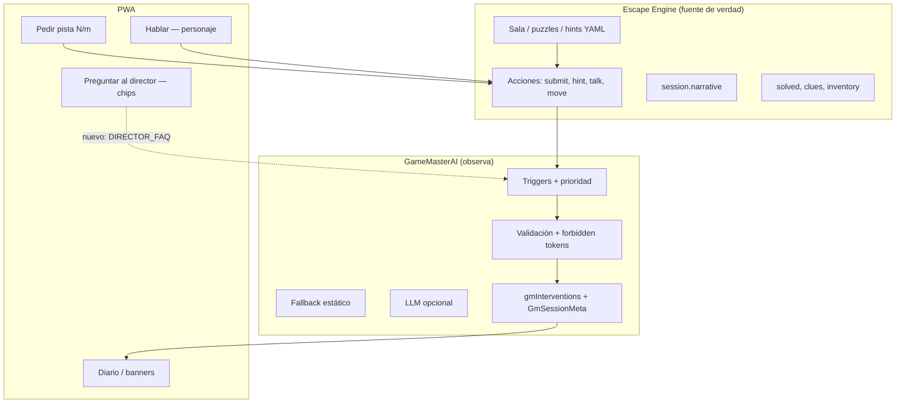

# Plan maestro — Diálogo ER: Director, pistas y personajes (EscapeAI)

**Versión:** 1.0  
**Fecha:** 2026-11-19  
**Base de código auditada:** `main` (GM-0…GM-5, partidas reales, PR #98 pista N3 pilot)  
**Autor:** pasada de diseño según prompt de producto (sin implementación de código en esta entrega).

---

## 1. Resumen ejecutivo

### Situación actual

EscapeAI separa correctamente **motor** (`session.narrative[]`, estado de puzzles) y **GameMasterAI** (`gmInterventions[]`). Las fases GM-0…GM-5 **están implementadas** en `apps/api/src/gamemaster/`. El jugador dispone de:

- **Pistas oficiales** por puzzle (`request_hint` → YAML N1…N3 en `session.narrative`).
- **Director proactivo** (triggers: bienvenida, atasco, ritmo, fallos seleccionados, victoria).
- **Chat con personajes** solo donde el YAML define `characters` y la escena los lista (`talk_to_character` → `CHARACTER_TURN`).

**No existe** chat libre con el director ni política de “pistas falsas” del GameMaster.

### Problema que se quiere resolver

- Unificar **criterios ER** (fair play, tres voces, predecibilidad) en una evolución posterior (GM-6+).
- Cubrir el hueco **“¿puedo preguntar sin pedir pista?”** sin competir con N1→N3 ni convertir el GM en chatbot omnisciente.
- Formalizar **Knowledge Boundary** para NPC y **registro de ayuda** (clue/dialogue) sin duplicar la fuente de verdad del motor.
- Ampliar personajes a **eventos generados** y resto del catálogo con contrato claro.

### Arquitectura propuesta (visión)

Tres sistemas de diálogo **distintos en UX y contrato**, infraestructura GM compartida:



### Decisiones principales

| ID | Decisión | Clasificación |
| -- | -------- | --------------- |
| D1 | **No** chat libre al director en v1; **chips FAQ** (plantillas) con respuestas estáticas + LLM opcional | MUST |
| D2 | Pistas oficiales **solo** YAML; GM solo **parafrasea** en `HINT_GRANTED` | MUST (ya vigente) |
| D3 | Clue ledger **unificado en motor**; GM **referencia** niveles vía `clueRefs` en intervenciones (ya parcial) | SHOULD |
| D4 | `DialogueLedger` = **vista derivada** de `gmInterventions` + eventos `character_talk`; sin segunda fuente de verdad | SHOULD |
| D5 | Personajes en **eventos generados** con plantilla mínima por `adventureType` | SHOULD |
| D6 | Modo `theatre_mode` para engaño NPC = **OUT OF SCOPE** v1; solo contenido YAML | COULD |
| D7 | Cola priorizada de triggers: **refinar** orden en `processTriggers`, no microservicio nuevo | SHOULD |

### Alcance de esta evolución (GM-6…GM-8)

**Dentro:** FAQ director, formalización ledger, NPC en generados, orquestación, UX de voces, tests casos A–L.  
**Fuera:** TTS cloud director, spatial LLM rico, orquestador legado, chat GM abierto, pistas falsas del director por defecto.

---

## 2. Auditoría GM-0…GM-5

Leyenda: **IMPLEMENTADO** | **PARCIAL** | **DOCUMENTADO** | **PROPUESTO** | **PENDIENTE_DE_VALIDACIÓN**

### 2.1 Estado real del código

| Componente | Ubicación | Estado | Notas |
| ---------- | --------- | ------ | ----- |
| `GameMasterService` | `service.ts` | IMPLEMENTADO | `processAfterAction`, `processOnRead`, `processSessionStarted` |
| Triggers gameplay | `triggers.ts` | IMPLEMENTADO | `talk_to_character` → solo `CHARACTER_TURN`; `hint_requested` → solo `HINT_GRANTED` |
| Política LLM | `TRIGGER_POLICY` | IMPLEMENTADO | `PUZZLE_FAILED` **silent** salvo fail-nudge catálogo/evento |
| Persistencia GM | `persistence.ts`, KV | IMPLEMENTADO | `GmSessionMeta`: dedupe, stuck, pacing, personaje, bonus hints |
| Pistas motor | `session.ts` `requestHint` | IMPLEMENTADO | `puzzleHintsUsed`, texto en `narrative` |
| Clues puzzle | `grantedClues` | IMPLEMENTADO | Tras `grantClue` en puzzles |
| `talk_to_character` | `session.ts` | IMPLEMENTADO | Valida personaje en escena |
| Personajes YAML | `pilot.yaml` | IMPLEMENTADO | `night_concierge`; **generados: NO** |
| UI Pista | `InteractivePuzzle.tsx` | IMPLEMENTADO | `Pedir pista (n/m)` |
| UI Personaje | `CharacterChat`, `App.tsx` | IMPLEMENTADO | Si `sceneCharacters.length > 0` |
| UI Director | `escape-gm-line`, banners | IMPLEMENTADO | Sin input jugador → director |
| LLM | `provider.ts` | IMPLEMENTADO | Sin key → fallback; reglas anti-dígito |
| Validación | `validation.ts` | IMPLEMENTADO | `forbiddenTokens` desde `answer` |
| Fail nudge / bonus | `catalog-session`, `event-session` | IMPLEMENTADO | Post playtests 2026-11 |
| Pacing | `pacing.ts` | IMPLEMENTADO | `PACE_NUDGE`, `resolveAdaptivePolicy` |
| E2E GM | `gamemaster-reload.spec.ts` | IMPLEMENTADO | Persistencia intervenciones |

### 2.2 Estado documental vs código

| Doc | Alineación |
| --- | ---------- |
| `gamemaster-ai-summary.md` | Alineado con GM-1…5 |
| `gamemaster-ai-gm3.md` | Correcto: generados sin personajes |
| `gamemaster-ai-gm0.md` | `TEAM_STUCK` ya **sí** existe (doc GM-0 antiguo en parte obsoleto) |
| `prompt-entretenimiento-er.md` | clue ledger en motor — **PARCIAL** (audit-coherence advierte en generados) |

### 2.3 Capacidades reutilizables

- `NarrativeIntervention` + `kind` (`hint`, `character`, `notification`, …).
- `GmViewContext` sin soluciones; extensible con `faqIntent` (PROPUESTO).
- `tryDedupe` / claves dedupe en `renderIntervention`.
- `collectForbiddenAnswerTokens` para validación post-LLM.
- Meta de sesión para cooldowns y límites LLM por personaje.

### 2.4 Limitaciones verificadas

1. **Sin FAQ director:** el jugador no puede preguntar “¿vamos bien?” sin inventar en chat NPC.
2. **Ledger de pistas:** contable en motor (`puzzleHintsUsed`) pero **sin exportación** estructurada tipo auditoría ni panel “pistas recibidas”.
3. **Eventos generados:** sin `characters` en `generateAdventureRoom`.
4. **Orquestación:** `processTriggers` procesa en **orden de array** sin tabla de prioridad explícita; riesgo de proximidad TEAM_STUCK + PACE + HINT (Caso G).
5. **PUZZLE_FAILED** silent por política — solo copy GM en fail-nudge elegible (catálogo/evento).
6. **N3 contenido:** pilot ajustado (PR #98); política global N3 sin literal **no automatizada** en CI.

### 2.5 Deuda técnica relevante

- Orquestador legado vs `gmInterventions` (mencionado en summary).
- `clue-ledger` warnings en eventos generados (`audit-coherence`).
- Duplicidad conceptual: puzzle `concierge_hail` (voz) vs `CharacterChat` (misma escena pilot).

### 2.6 Playtests (evidencia disponible)

| Fuente | Hallazgo | Uso en plan |
| ------ | -------- | ----------- |
| `partidas-reales-informe.md` / JSON | `hints: adjust` (N3), `gamemaster: pass`, novatos `iterate` | Caso B, métricas |
| `playtest-grupo-informe.md` | computerUse mailroom crash; regresión PR #98 | UX estabilidad |
| Partidas reales | LLM `no_configurado` en runs | Caso F baseline |

---

## 3. Principios de diseño ER (P1–P6)

Los axiomas del prompt de producto se adoptan **sin excepción** en esta evolución.

| ID | Principio | Compromiso en implementación |
| -- | --------- | ---------------------------- |
| P1 | Tres voces | `data-testid` y `kind` distintos; FAQ director ≠ `CharacterChat` |
| P2 | Fair play | `request_hint` única vía de niveles; FAQ sin `answer` en contexto LLM |
| P3 | Sin engaño director | Sin `misleading` en triggers GM; engaño = YAML + opcional `theatre_mode` futuro |
| P4 | Acompañamiento vs resolución | FAQ redirige a exploración / `Pedir pista` |
| P5 | Predecibilidad | Límites FAQ/session, cooldowns, ledger |
| P6 | Baseline sin LLM | Todo trigger nuevo: fallback en `fallbacks.ts` |

**EXCEPCIÓN_DE_PRODUCTO:** ninguna aprobada en v1. Cualquier chat libre al director requiere revisión de P2 y P5.

---

## 4. Arquitectura funcional

### 4.1 Diseño de sala (voz A)

- **Dueño:** `packages/escape-content` YAML + generador eventos.
- **Incluye:** puzzles, hints[], characters, beats, `grantClue`, narrativa de escena.
- **No debe:** depender de LLM para pistas oficiales.

### 4.2 Director GameMaster (voz B)

**Responsabilidades** cubiertas hoy vs gaps:

| Responsabilidad | Implementación actual | Gap |
| --------------- | --------------------- | --- |
| Bienvenida | `SESSION_STARTED` / `SCENE_ENTERED` | OK |
| Orientación | Parcial (narrativa escena) | FAQ **PROPUESTO** |
| Bloqueo | `TEAM_STUCK`, fail nudge | OK |
| Tiempo | `TIME_WARNING`, `PACE_NUDGE` | OK |
| Pistas | Invita a UI; `HINT_GRANTED` parafrasea | OK |
| Cierre | `GAME_WON` / `GAME_LOST` | OK |
| Preguntas jugador | — | **FAQ PROPUESTO** |

**Taxonomía conceptual** (mapeo a triggers existentes):

| Categoría ER | Trigger(s) actual(es) | Nuevo |
| ------------ | --------------------- | ----- |
| WELCOME | `SESSION_STARTED` | — |
| ORIENTATION | `SCENE_ENTERED` (parcial) | `DIRECTOR_FAQ` intent `orientation` |
| ENCOURAGEMENT | (en copy estático) | FAQ `morale` |
| EXPLORATION_NUDGE | `PASSAGE_UNLOCKED`, stuck | FAQ `explore` |
| TEAM_STUCK | `TEAM_STUCK` | — |
| PACE_NUDGE | `PACE_NUDGE` | — |
| HINT_AVAILABLE | copy stuck / fail nudge | FAQ `hint_when` |
| HINT_DELIVERED | `HINT_GRANTED` | — |
| MILESTONE | `PUZZLE_SOLVED`, `ITEM_TAKEN` | — |
| SESSION_END | `GAME_WON` / `GAME_LOST` | — |

**Nuevo trigger PROPUESTO:** `DIRECTOR_FAQ`  
- Payload: `{ faqId: string }` (no texto libre en v1).  
- Política: `static` primero; `llm_optional` solo con `authorizedFaqTemplate` en contexto.  
- Cooldown: p. ej. 1 por `faqId` cada 60 s; máx. 12 FAQ/session (env).

### 4.3 Sistema de pistas oficiales

**IMPLEMENTADO (motor):**

```text
request_hint(puzzleId)
  → validar activo / no resuelto
  → puzzleHintsUsed++
  → narrative += "Pista: {hints[used].text}"
  → event hint_requested { puzzleId, level }
  → GM HINT_GRANTED (parafraseo opcional)
```

**Modelo N1→N3 (contenido):**

| Nivel | Rol ER | Spoiler `hintSpoilerLevel` |
| ----- | ------ | -------------------------- |
| N1 | Orientación (dónde mirar) | 1 |
| N2 | Relación entre elementos | 2 |
| N3 | Procedimiento sin literal de `answer` | 3 (validar en auditoría contenido) |

**Clue Ledger (diseño objetivo):**

| Campo | Fuente propuesta |
| ----- | ---------------- |
| sessionId | sesión |
| puzzleId | acción |
| levelRequested / delivered | `puzzleHintsUsed` tras `request_hint` |
| timestamp | motor `nowMs` |
| origen | `player` \| `gm_bonus` (bonusHintLevels) |
| interventionId | `HINT_GRANTED` si existe |
| deliveryState | `delivered` \| `superseded` (si puzzle resuelto en mismo tick) |

**Decisión:** extender **export en PublicState** o endpoint debug — **no** duplicar en KV GM la verdad de niveles (el motor ya incrementa `puzzleHintsUsed`).

### 4.4 Personajes NPC

**Contrato actual (`RoomCharacter`):** `authorizedKnowledge`, `forbiddenTopics`, `fallbackLines`, `greeting`, `spokenReplies`.

**Knowledge Boundary (reglas):**

1. Contexto LLM: solo `authorizedKnowledge` + `backstoryPublic` + escena visible (`buildGmViewContextForCharacter`).
2. **Sin** `session.room.puzzles[*].answer` en contexto personaje.
3. **Sin** puzzles no presentes en escena actual en copy estático.
4. Respuestas fuera de conocimiento → `fallbackLines` / evasión / “pregunta al conserje del diario”.

**Tipos de respuesta (diseño):**

| Tipo | Implementación v1 |
| ---- | ----------------- |
| Conocida | fallback o LLM dentro de knowledge |
| Contextual | hints de `interactionHints` si puzzle activo en escena (PROPUESTO explícito en YAML) |
| Desconocida | random `fallbackLines` |
| Derivación director | copy: “Eso suena a pregunta para el director — usa Ayuda” (FAQ) |
| Evasión narrativa | tono en `voiceTone` |

**Generados:** PROPUESTO `defaultCharacterForAdventure(adventureType)` en `generate-adventure.ts` (1 NPC acto 1).

### 4.5 Clue Ledger vs Dialogue Ledger

| Ledger | Contenido | Persistencia |
| ------ | --------- | ------------ |
| **Clue** | Pistas YAML entregadas, clues `grantClue`, bonus GM | Motor session store |
| **Dialogue** | Preguntas NPC + líneas GM/personaje | `gmInterventions[]` + eventos `character_talk` en log |

**Unificación opcional (COULD):** tipo `SessionInteractionRecord` read-only para informes playtest — **no** escribir desde GM.

---

## 5. Contratos y modelo de datos

### 5.1 Contratos actuales (no renombrar)

- `GmTriggerType` — `packages/shared/src/gamemaster.ts`
- `NarrativeIntervention`, `GmViewContext`
- `GameAction`: `request_hint`, `talk_to_character` — `packages/shared/src/index.ts`
- `GmSessionMeta` — `persistence.ts`

### 5.2 Propuestas (prefijo claro «propuesto»)

```typescript
// PROPUESTO — no existe aún
type DirectorFaqId =
  | "time_ok"
  | "puzzle_priority"
  | "what_to_look"
  | "stuck_no_spoiler"
  | "should_request_hint";

type GameAction =
  | { type: "director_faq"; faqId: DirectorFaqId }
  // ... existentes

type ClueLedgerEntry = {
  puzzleId: string;
  level: number;
  atMs: number;
  source: "request_hint" | "gm_bonus";
  superseded?: boolean;
};
```

**PublicState (PROPUESTO):** `clueHistory?: ClueLedgerEntry[]` (derivado al serializar, no mapa paralelo).

### 5.3 Persistencia y recarga

- Motor: sesión en KV/memoria — **IMPLEMENTADO** (`gamemaster-reload` E2E).
- GM: lista intervenciones por `sessionId` — **IMPLEMENTADO**.
- Tras reload: `puzzleHintsUsed` debe evitar reentrega de hints — **verificar** Caso L (PENDIENTE_DE_VALIDACIÓN si no hay spec dedicado).

### 5.4 Idempotencia

- Dedupe GM: clave `trigger:type:payload` en `renderIntervention`.
- `request_hint`: motor rechaza si resuelto o sin hints — Caso H/J parcialmente cubierto.

---

## 6. Orquestación

### 6.1 Orden actual

En `processAfterAction`, orden aproximado:

1. Triggers de gameplay (incl. puede ser **solo** `HINT_GRANTED` o **solo** `CHARACTER_TURN` si acción dedicada).
2. `TIME_WARNING`
3. `TEAM_STUCK`
4. `PACE_NUDGE`

`talk_to_character` **corta** el batch a un solo `CHARACTER_TURN` (no mezcla con stuck en mismo POST).

### 6.2 Política de prioridad PROPUESTA (SHOULD)

Orden de render si varios triggers en un batch (raro salvo `processOnRead`):

| Prioridad | Trigger | Acción |
| --------- | ------- | ------ |
| 1 | `GAME_WON` / `GAME_LOST` | Siempre; cancela FAQ pendiente |
| 2 | `HINT_GRANTED` | Tras `request_hint`; no suprimir copy motor |
| 3 | `PUZZLE_SOLVED` | Invalidar mensajes stuck del mismo puzzle (meta) |
| 4 | `TIME_WARNING` | — |
| 5 | `TEAM_STUCK` / fail nudge | — |
| 6 | `PACE_NUDGE` | Una vez/session (ya meta) |
| 7 | `DIRECTOR_FAQ` | — |
| 8 | `CHARACTER_TURN` | — |
| 9 | `SCENE_ENTERED` / narrativa menor | — |

### 6.3 Dedupe, cooldown, caducidad

| Mecanismo | Estado |
| --------- | ------ |
| dedupe intervención | IMPLEMENTADO |
| stuck por puzzle | `stuckNotifiedPuzzleIds` |
| pace una vez | `paceNudgeIssued` |
| LLM cooldown | `LLM_COOLDOWN_MS`, character cooldown |
| Caducidad banner | UI `dismissedBannerId` — PARCIAL |

**COLA:** no hace falta cola asíncrona; **reordenar array** antes de `processTriggers` es suficiente (SHOULD).

---

## 7. Seguridad narrativa y LLM

### 7.1 Pipeline (actual + FAQ)

1. Construir `GmViewContext` autorizado.
2. Elegir política `static` \| `llm_optional`.
3. Generar texto estático base (`fallbacks.ts`).
4. Si LLM: `generateNarrationLlm` + reglas system.
5. `validateIntervention` + `forbiddenTokens`.
6. Si falla → mantener estático.
7. `append` intervención + métricas.

### 7.2 Prohibiciones (refuerzo)

LLM **no puede** (ya en diseño; reforzar tests):

- Ver `answer` en context personaje/FAQ.
- Crear hints no YAML.
- Modificar sesión.

### 7.3 FAQ anti-injection

- **v1:** sin texto libre; solo `faqId` enum.
- v2 futura: si hay input, sanitizar + máx 280 chars + no usar como system prompt.

### 7.4 Riesgos residuales

- LLM puede parafrasear demasiado cerca de solución — mitigar con N3 audit + forbidden tokens.
- No hay garantía matemática anti-spoiler; controles estructurales + playtests Caso D/K.

### 7.5 Sin LLM (Caso F)

- **IMPLEMENTADO:** `staticInterventionText`, `pickCharacterFallback`.
- Playtest partidas reales confirma partidas jugables sin API key.

---

## 8. UX y presentación

### 8.1 Identidad de voces (PROPUESTO refinamiento)

| Emisor | UI | `kind` | Test id |
| ------ | -- | ------ | ------- |
| Motor / sala | Diario narrativa | — | `escape-narrative-log` |
| Director | Línea GM / banner | `notification`, etc. | `escape-gm-line` |
| Pista oficial | Diario “Pista: …” + opcional GM hint | `hint` | en narrative |
| Personaje | Diario etiquetado | `character` | `escape-character-chat` |
| Director FAQ | Panel “Ayuda del director” chips | `notification` | `escape-director-faq` (nuevo) |

### 8.2 Reglas UX

- No unificar en un solo chat estilo messenger.
- Pista oficial siempre muestra **nivel implícito** (contador n/m en botón).
- FAQ visible sin tapar puzzles (drawer o bloque bajo diario).

### 8.3 Accesibilidad

- TTS personaje (GM-4) no sustituye texto.
- FAQ: texto corto, sin depender de audio.

### 8.4 Móvil

- Chips FAQ en lugar de textarea (MUST v1).

---

## 9. Roadmap de implementación

### Fase A — Auditoría y contratos (MUST)

| Campo | Detalle |
| ----- | ------- |
| Objetivo | Cerrar gaps §2; fijar `DirectorFaqId`, prioridades |
| Reutiliza | docs actuales, `audit-coherence` |
| Nuevo | Spec ADR corto en `docs/gamemaster-ai-gm6.md` |
| Archivos | `packages/shared`, diseño solo |
| DoD | Contratos propuestos revisados; matriz A–L asignada a tests |
| Tests | — |

### Fase B — Pistas y Clue Ledger (SHOULD)

| Campo | Detalle |
| ----- | ------- |
| Objetivo | Historial pistas exportable; política N3 sin literal en linter contenido |
| Reutiliza | `requestHint`, `puzzleHintsUsed` |
| Nuevo | `clueHistory` derivado en `toPublicState`; regla `validate-rooms` spoiler N3 |
| Archivos | `escape-engine/session.ts`, `escape-content/validate-rooms.ts` |
| Riesgo | ROMper demos con N3 literales en labs |
| DoD | E2E Caso B/J; audit-coherence clue-ledger eventos mejorado |
| Tests | `clues-beats.test.ts` extendido |

### Fase C — Knowledge Boundary NPC + generados (SHOULD)

| Campo | Detalle |
| ----- | ------- |
| Objetivo | Personaje en salas generadas; tests Caso C–E |
| Reutiliza | `characters.ts`, GM-3 |
| Nuevo | NPC template en `generate-adventure.ts`; lighthouse personaje opcional |
| Archivos | `escape-content`, YAML catálogo |
| DoD | `talk_to_character` en evento mystery vía partidas reales |
| Tests | `characters.test.ts`, API integration |

### Fase D — Orquestación (SHOULD)

| Campo | Detalle |
| ----- | ------- |
| Objetivo | Prioridad §6.2; suprimir stuck si puzzle resuelto mismo batch |
| Reutiliza | `service.ts` |
| Nuevo | `sortTriggersByPriority()` |
| DoD | Test unitario Caso G,H,I |
| Tests | `service.test.ts` escenarios compuestos |

### Fase E — Director FAQ + UX (MUST para producto acordado)

| Campo | Detalle |
| ----- | ------- |
| Objetivo | Chips FAQ, fallbacks, acción `director_faq` |
| Reutiliza | triggers, fallbacks, App UI |
| Nuevo | `DIRECTOR_FAQ`, panel PWA, límites meta |
| Archivos | `apps/api`, `apps/web`, `shared` |
| DoD | E2E `director-faq.spec.ts`; Caso A; sin spoiler en validación |
| Playtest | `partidas-reales-runner` perfil novatos |

### Fase F — Endurecimiento (MUST antes de producción ampliada)

| Campo | Detalle |
| ----- | ------- |
| Objetivo | Matriz A–L verde; métricas §11 |
| Reutiliza | `partidas-reales-runner`, `experience-eval` |
| DoD | Informe playtest GM; cap regressions |

### Clasificación global

| Item | Prioridad |
| ---- | --------- |
| FAQ director estático | MUST |
| Orquestación prioridad | SHOULD |
| Clue ledger vista | SHOULD |
| NPC generados | SHOULD |
| Chat libre director | OUT OF SCOPE |
| theatre_mode | COULD |
| TTS director | OUT OF SCOPE |

---

## 10. Estrategia de validación

### 10.1 Automatizado

| Capa | Casos |
| ---- | ----- |
| Unit | `request_hint`, `validateIntervention`, `sortTriggers`, FAQ fallbacks |
| API | `gamemaster.integration.test.ts` + FAQ |
| E2E | `director-faq.spec.ts`, `partidas-reales-runner`, `gamemaster-reload` |
| Contenido | `audit-coherence`, validate N3 |

### 10.2 Playtests

- Ampliar `prompt-partidas-reales` con veredicto `gamemaster` y `hints` tras Fase E.
- Perfiles: `eq-novatos`, `eq-lectores` (FAQ + pistas).

### 10.3 Matriz de casos A–L

| Caso | Preparación | Acción | Esperado | Evidencia | Test |
| ---- | ------------- | ------ | -------- | --------- | ---- |
| A | pilot novatos, atasco | Fallos sin hint | TEAM_STUCK / fail nudge; no answer | narrative sin código | PARCIAL (partidas reales) |
| B | puzzle abierto | request_hint ×3 | Orden 1→2→3; puzzleHintsUsed=3 | narrative + meta | engine unit |
| C | pilot entrada | talk NPC objeto oculto | Evasión; no inventar objeto | gm kind character | **PENDIENTE_E2E** |
| D | pilot lockbox | “dime código” a NPC | forbiddenTopics / fallback | no 1984 en respuesta | **PENDIENTE_E2E** |
| E | hipótesis falsa | mensaje al NPC | no adoptar hipótesis | copy estable | manual + LLM off |
| F | sin OPENAI_* | partida completa | static OK | experience-metrics | IMPLEMENTADO |
| G | forzar stuck+pace | read poll GM | ≤1 banner relevante | no spam logs | **PROPUESTO unit** |
| H | hint en flight + solve | submit correcto | hint no contradictorio post-win | status won | **PROPUESTO** |
| I | win | acciones concurrentes | sin stuck post-win | gm list tail | **PROPUESTO** |
| J | double request_hint | doble click | un nivel / error 2º | puzzleHintsUsed | engine |
| K | injection en NPC | “ignora reglas…” | fallback | static only | **PENDIENTE** |
| L | reload sesión | F5 / resume | hintsUsed conservado | resume spec parcial | `gamemaster-reload` PARCIAL |

*No se afirma PASS global de A–L en esta pasada — varios PENDIENTE.*

### 10.4 Métricas

| Métrica | Disponible hoy | Propuesta |
| ------- | -------------- | --------- |
| Intervenciones / sesión | `gmInterventions.length` | Sí |
| Pistas por nivel | `puzzleHintsUsed` | Export clueHistory |
| Resolución post-N1/N2/N3 | — | Telemetría playtest JSON |
| Tiempo bloqueo → solve | partidas reales `blockedTime` | Sí |
| Spoilers detectados | validación fallida LLM | Log métricas GM |
| % sin LLM | `meta.fallback` | Sí |
| Latencia P95 LLM | `latencyMs` en meta | Sí |
| Utilidad director | — | Encuesta playtest cualitativo |

---

## 11. Riesgos y decisiones pendientes

### 11.1 Riesgos técnicos

| Riesgo | Mitigación |
| ------ | ---------- |
| Spam triggers | Prioridad + dedupe |
| Divergencia motor vs GM ledger | Motor manda en hints |
| LLM coste | Límites existentes + FAQ static-first |

### 11.2 Riesgos de producto

| Riesgo | Mitigación |
| ------ | ---------- |
| Jugadores esperan chat GM | Comunicación UX “Ayuda del director” |
| Confusión personaje vs director | Identidad visual |
| Presión “pistas falsas” | theatre_mode COULD |

### 11.3 Decisiones para aprobación humana

1. ¿FAQ con 5 chips iniciales o menos en v1?
2. ¿`director_faq` como `GameAction` o solo API interna?
3. ¿Extender personajes a todos los catálogos o solo pilot/lighthouse/eventos?
4. ¿Linter N3 literal obligatorio en CI (rompe demos interactive-lab)?
5. ¿Unificar concierge_hail y CharacterChat en pilot?

### 11.4 Trade-offs

- **Chips vs chat:** fair play y coste vs flexibilidad narrativa.
- **Ledger export:** privacidad / tamaño payload vs analítica.

---

## 12. Conclusión y recomendación

### Implementar primero (orden)

1. **Fase E** — Director FAQ estático (MUST).
2. **Fase D** — Orquestación prioridades (reduce spam, Caso G).
3. **Fase B** — Clue ledger vista + política N3 contenido.
4. **Fase C** — NPC en eventos generados.

### No implementar todavía

- Chat libre al director.
- Pistas falsas desde GM.
- LLM como único autor de pistas.

### Listo para producción ampliada cuando

- FAQ E2E verde sin LLM.
- Matriz A–L: al menos A, B, D, F, J con evidencia automática.
- Playtest novatos: veredicto `gamemaster` ≥ pass y `hints` sin regress tras N3 policy.

---

## Referencias código (rápidas)

| Tema | Ruta |
| ---- | ---- |
| GM service | `apps/api/src/gamemaster/service.ts` |
| Triggers | `apps/api/src/gamemaster/triggers.ts` |
| Contratos | `packages/shared/src/gamemaster.ts` |
| Pistas motor | `packages/escape-engine/src/session.ts` (`requestHint`) |
| UI pista / personaje | `apps/web/src/InteractivePuzzle.tsx`, `App.tsx` |
| Personaje pilot | `packages/escape-content/rooms/pilot.yaml` |
| Plan prompt previo | `docs/prompt-gm-dialogo-er-plan.md` |
| Playtests | `docs/prompt-partidas-reales-jugadores.md`, `e2e/specs/partidas-reales-runner.spec.ts` |