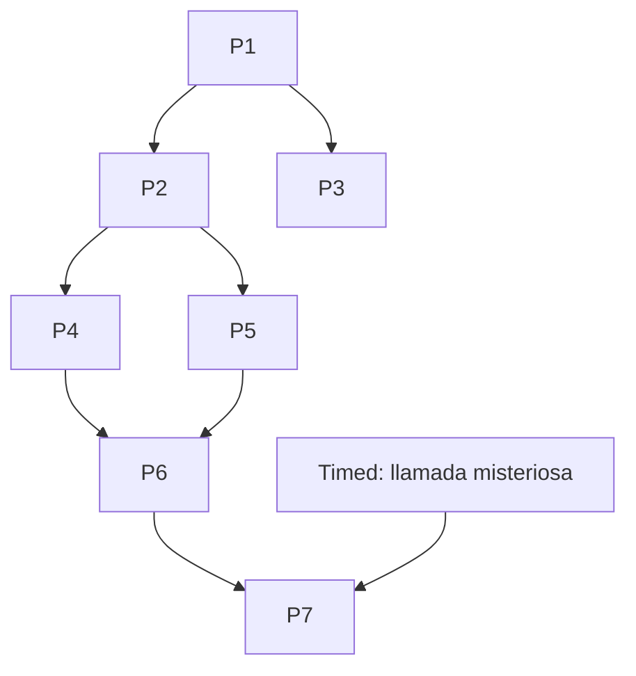

# El caso de los seis sospechosos — Diseño de experiencia

Documento de referencia para validar que `GameDefinition`, motor, multiplayer e IA GM soportan una partida real.  
**Jugadores:** 6 · **Duración:** 60 min · **Roles activos:** 3 (2 jugadores por rol).

## Premisa

En la mansión Ashford, la coleccionista **Elena Valls** ha desaparecido durante una cena privada. Seis invitados permanecen en salón con puertas cerradas hasta que llegue la policía. Deben reconstruir la noche, descifrar evidencias y decidir **a quién del grupo (o qué hipótesis externa)** señalar antes de que el temporizador expire.

## Roles (3 × 2 jugadores)

| role_id | Nombre | Capacidad mecánica | Objetivo narrativo |
|---------|--------|--------------------|--------------------|
| `investigator` | Investigador | Ve **línea temporal resumida** en Host view traducida a pista estructurada | Cruzar coartadas |
| `cryptographer` | Criptógrafo | Puede **validar cifrado** (puzzle P4 sin intentos extra) | Descifrar nota anónima |
| `interrogator` | Interrogador | Único que abre **chat NPC** (P6) | Sacar contradicción al sospechoso |

Asignación en lobby: first-come o auto-shuffle equilibrado (2+2+2).

## Seis pistas privadas (una por jugador, slot 1–6)

| clue_id | Slot | Contenido (resumen) | Usada en |
|---------|------|---------------------|----------|
| `clue_alibi_marcos` | 1 | Marcos vio a Elena en biblioteca 21:40 | P3 lógica |
| `clue_alibi_lucia` | 2 | Lucía escuchó cristal roto 21:55 | P3 |
| `clue_key_fragment_a` | 3 | Fragmento código caja fuerte: `7` | P5 coop |
| `clue_key_fragment_b` | 4 | Fragmento código: `3` | P5 coop |
| `clue_cipher_key` | 5 | Clave Vigenère: `ASHFORD` | P4 |
| `clue_witness_note` | 6 | Nota manuscrita “no subir al ático” | P2 + QR |

Todas `defaultVisibility: shareable` salvo `clue_cipher_key` (**private** hasta que Criptógrafo resuelva P4 o comparta).

## Siete pruebas

| id | Tipo | Fase | Visibilidad | Dependencias | Validación |
|----|------|------|-------------|--------------|------------|
| **P1** `scene_observation` | observation | `phase_1` | public | — | exact: `reloj roto` (normalized) |
| **P2** `attic_code` | code | `phase_2` | public | P1 | exact: `419` (nota slot 6 + PDF) |
| **P3** `timeline_logic` | logic | `phase_2` | role_gated (investigator lead) | P1 | custom_rule: `timeline_order_v1` |
| **P4** `anonymous_note` | cipher | `phase_3` | role_gated (cryptographer) | P2, clue_cipher_key | normalized: `el atico guarda la verdad` |
| **P5** `safe_combination` | cooperation | `phase_3` | public | P2, fragments shared | combination items + min 2 players |
| **P6** `interrogate_victor` | interrogation | `phase_4` | role_gated (interrogator) | P4, P5 | keyword set + flag `victor_contradiction` |
| **P7** `final_accusation` | narrative_choice | `phase_5` | public | P6, flag timed | multiple_choice → final weights |

### Medios físicos / digitales

| Prueba | Presentación |
|--------|----------------|
| P1 | digital (imagen escena en móvil) |
| P2 | **QR** en marco del pasillo → URL one-shot con pista ático |
| P3 | digital |
| P4 | digital |
| P5 | digital |
| P6 | digital (chat GM/NPC) |
| P7 | digital |
| — | **PDF imprimible** `asset_dossier` (dossier policía: timeline, huellas, recorte periódico) — soporte P2/P3 |

## Dos pruebas cooperativas

1. **P5 `safe_combination`:** requiere que al menos **dos jugadores distintos** hayan compartido `clue_key_fragment_a` y `clue_key_fragment_b` (o los aporten en UI coop). Validación `combination` + `minDistinctPlayers: 2`.
2. **P3 `timeline_logic`:** Investigadores aportan orden; **resto del grupo confirma** con `COOP_PUZZLE_CONTRIBUTE` (voto mayoría 4/6) — `minDistinctPlayers: 4`.

## Dependencias (grafo)

## Eventos narrativos

| event_id | Disparo | Efecto |
|----------|---------|--------|
| `narr_intro` | al `running` | intro GM (texto) |
| `timed_phone_30` | `elapsed >= 30min` OR GM tool `trigger_timed_event` | audio/texto: “llamada anónima” → flag `phone_tip` (pista hacia P7) |
| `phase_3_enter` | P4 solved | texto tensión + desbloqueo P6 UI |

## NPC: Víctor Mendoza (sospechoso externo vía pantalla)

- **No es jugador.** Personaje IA/script vinculado a P6.
- **Conocimiento autorizado:** ficha pública del dossier + lo que el grupo ya resolvió (P1–P5 flags).
- **Mecánica:** Interrogador envía mensajes; servidor detecta keywords (`áttico`, `21:55`, `cristal`) → flag `victor_contradiction` → desbloquea opción correcta en P7.
- **Fase 3 sin LLM:** árbol script en `npc_victor_scripts.json`; Fase 5 sustituye respuestas por LLM con mismas tools.

## Finales (P7)

| final_id | Condición | Desenlace |
|----------|-----------|-----------|
| `final_correct` | choice `accuse_victor` + flag `victor_contradiction` | Elena encontrada en ático; Víctor delatado |
| `final_wrong_internal` | choice acusa a otro jugador | final trágico / comisaría equivocada |
| `final_timeout` | timer agotado sin P7 | epílogo ambiguo |

Pesos en `narrative.finales` vía flags `phone_tip`, puzzles solved.

## Flujo jugador (60 min, orientativo)

| Min | Hito |
|-----|------|
| 0–5 | Lobby, roles, intro |
| 5–15 | P1 escena + compartir pistas alibi |
| 15–25 | P2 QR + PDF dossier |
| 25–35 | P3 timeline coop + P4 cifrado |
| 35–45 | P5 caja fuerte |
| 45–55 | P6 interrogatorio |
| 55–60 | P7 acusación + epílogo |

## Comprobación arquitectónica

| Requisito producto | Elemento en diseño |
|--------------------|-------------------|
| Info distribuida | 6 pistas privadas + 2 fragmentos coop |
| Cooperación obligatoria | P3 (4 jugadores), P5 (2+) |
| NPC IA | P6 / Víctor |
| GM eventos | intro + timed + phase enter |
| PDF + QR | dossier + P2 |
| Final ramificado | P7 + flags |
| Presencial/remoto | mismos IDs; QR opcional en remoto (host muestra QR en pantalla) |

Este documento es la fuente para `fixtures/six-suspects/game-definition.json` en Fase 3.
